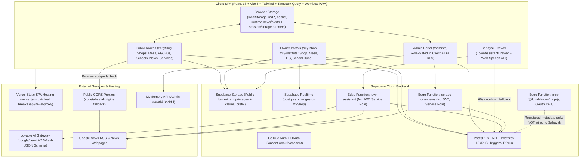
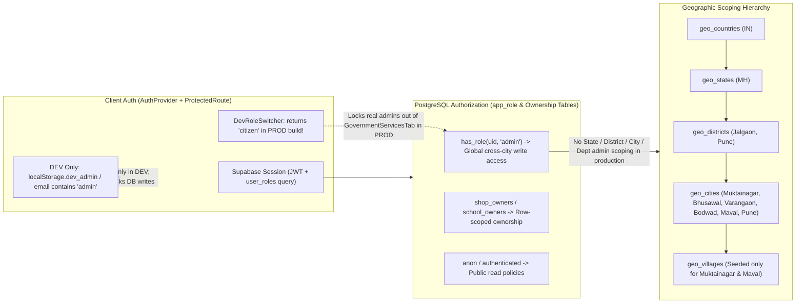

# ApnaTown — Comprehensive Technical Implementation Audit

**Audit Subject:** ApnaTown (`muktainagar-daily-main` / runtime brand **ApnaLocal**)  
**Audit Scope:** Existing source code, SQL migrations/patches, Supabase Edge Functions, MCP bindings, build/deploy configs, i18n bundles, and test suite (strictly read-only; zero files modified or refactored)  
**Target Audience:** External Technical Evaluation & Architecture Review  
**Verification Basis:** Direct source code inspection across `src/`, `supabase/`, `docs/patches/`, `scripts/`, config files (`package.json`, `vite.config.ts`, `vercel.json`, `tsconfig.app.json`), and live execution of the automated test suite (`vitest run`: 31/31 files, 252/252 tests passing under mocked Supabase).

> **Naming & Brand Honesty Note:** The string `"ApnaTown"` does not appear in application source code or configuration. The codebase actively transitions between the legacy brand **Muktainagar Daily** (`src/lib/mcp/index.ts`, `localStorage` keys prefixed `md.*` / `md_banner_*`, `scripts/generate-sitemap.ts`, `public/llms.txt`) and the current runtime multi-town brand **ApnaLocal** (`src/lib/geo/townConfig.ts`, `src/hooks/useCity.tsx`, `src/components/TownAssistantDrawer.tsx`). All findings in this audit reflect the actual codebase state under `muktainagar-daily-main`.

---

## Executive Summary & Launch-Readiness Verdict

### Verdict: **NOT PRODUCTION-READY FOR EXTERNAL / MULTI-TENANT ROLLOUT** (Suitable Only as a Controlled Single-Town / Closed Multi-Town Beta)

ApnaTown (ApnaLocal) has a **substantial, well-structured React/TypeScript frontend**, rich **consumer UX** (bilingual EN/MR directory, fuzzy search, Mess daily menus, PG vacancy views, Education portal with institute owner hub, Bus timetable, Local News reader, and Gemini-backed Sahayak drawer), and **meaningful recent hardening** in the Education Owner Hub, review sanitization, CSV formula-injection defense, open-redirect guards, and an admin-only Storage & System Health diagnostic module.

However, **an honest external evaluation shows critical structural blockers** that make unguarded public or multi-town SaaS launch unsafe today:

1. **Unauthenticated, Service-Role Edge Functions (Critical):** Both `supabase/functions/town-assistant/index.ts` and `supabase/functions/scrape-local-news/index.ts` execute with `SUPABASE_SERVICE_ROLE_KEY`, accept wildcard `*` CORS, perform **no JWT or role checks**, and lack rate limiting—exposing server-side `LOVABLE_API_KEY` Gemini quota exhaustion, unauthenticated SSRF via `customUrl`, and unauthenticated database writes to `local_news` / `news_sources`.
2. **Broken Role-Gating & Production Admin Lockout (Critical):** Real Postgres RBAC only implements global `'admin'`, `'shopkeeper'`, and `'user'` (`app_role`). The advertised hierarchical/departmental roles (State, District, City/Village, News, Business, Water, Electricity, Transport) **do not exist in production authorization**. Worse, `src/components/admin/GovernmentServicesTab.tsx` unconditionally renders a DEV-only persona switcher (`src/lib/services/devRoleSwitcher.ts`) whose helper returns `'citizen'` in production builds—**locking legitimate admins into Read-Only mode in production** unless overridden in the UI.
3. **Production `[DEMO]` & Simulated Data Leaks (Critical):** Multiple production screens silently inject hardcoded demo fixtures or `localStorage` overlays into live pages: `src/pages/Home.tsx` and `src/pages/EssentialServices.tsx` render `[DEMO]` alerts and `"Demo Simulation System"` records (and `GovernmentServicesTab.tsx` / `AuthorityCsvImportModal.tsx` stamp newly created admin announcements with `is_demo: true`), `src/lib/living/livingService.ts` returns hardcoded Muktainagar `DEMO_MESSES` / `DEMO_PGS` for empty towns, and `src/pages/BusTimetable.tsx` leaks cached timetables across towns (`md.bus.v1.rows` lacks `city_id`).
4. **Broken Database Migration Replay & Schema Drift (Critical):** Clean `supabase db reset` on `supabase/migrations/` alone cannot reproduce the production database: core schemas (`geo_*`, `schools` base, `bus_timetable`, `mcp_endpoints`, `authority_*`, and security hardening patches) live in `docs/patches/`, `supabase/migrations/20260515050933_53e333df-28f4-45fa-b00a-2b7a8e49feaa.sql` contains an **unrelated third-party store migration ("New Harsh Mobile")** with an open `claim_first_admin()` bootstrap, and `supabase/master_schema.sql` diverges from both migrations and frontend queries.
5. **Client Reliability & Security Bugs Masked by Disabled TypeScript Checks (High):** `tsconfig.app.json` disables `strict` and `noImplicitAny` while `npm run build` omits `tsc --noEmit`. As a result, three upload components pass an options object to `compressImage(file, maxWidth, quality)` causing `NaN` canvas failures, `updateWithConcurrency()` silently performs unconditional blind overwrites on conflict, inactive (`is_active = false`) shops remain publicly readable under `"Admins insert shops"` / `USING (true)` policies, and `RequestListingModal` stores raw base64 `data:` URIs when storage upload fails.
6. **Zero Revenue Infrastructure & Zero Audit Trail (High):** Monetization consists solely of an unauthenticated client-metered banner slot system (`public.banners`) with broken `target_level` constraints (`'global'` vs `'all'`), no `target_state_id` column, and no payments, subscriptions, invoices, advertiser self-serve, or sponsored shop ranking. Administrative actions have **zero audit logging**.

| Dimension | Current Maturity | Honest Readiness |
|---|---|---|
| **Public Consumer Directory (Single-Town)** | High UI polish, 7 live verticals | **Beta-ready** once `[DEMO]` overlays & CORS/proxy issues are fixed |
| **Sahayak AI Assistant** | Strong JSON-schema Gemini pipeline + local fallback | **Beta-ready** functionally, **Blocked** on missing auth, rate-limits & unverified card text |
| **Multi-Tenant / Geo Expansion** | 5-tier schema exists; UI & data queries still Muktainagar-biased | **Partially ready** — needs strict `city_id` scoping & state UI |
| **Admin RBAC & Governance** | Monolithic `'admin'` UI; missing scoped roles & audit logs | **Not ready** for delegated town/dept admins |
| **Monetization & Billing** | Banner slots only; zero payment/subscription stack | **Not ready** for commercial SaaS |
| **Security & DB Governance** | Split migrations, unauth edge endpoints, RLS & concurrency gaps | **Blocked** — P0 remediation required before public launch |

---

## System Architecture Diagrams

### 1. High-Level System Architecture



### 2. Sahayak AI End-to-End Request & Fallback Flow

```mermaid
sequenceDiagram
  actor User
  participant Drawer as TownAssistantDrawer.tsx
  participant ClientSvc as assistantService.ts
  participant EdgeFn as Edge: town-assistant/index.ts
  participant DB as Supabase PostgREST (Service Role)
  participant Gemini as Lovable AI Gateway (gemini-2.5-flash)

  User->>Drawer: Types query or selects quick prompt
  Drawer->>ClientSvc: askTownAssistant(query, cityId, citySlug, villageId, history[0..5])

  alt AI enabled & not in 60s error cooldown
    ClientSvc->>EdgeFn: supabase.functions.invoke("town-assistant") [No JWT / Rate Limit]
    EdgeFn->>EdgeFn: Validate query (400 chars) & cityId UUID
    par Parallel Geo-Scoped Reads
      EdgeFn->>DB: shops (select * + categories, limit 80)
      EdgeFn->>DB: bus_timetable (limit 40)
      EdgeFn->>DB: schools (limit 40)
      EdgeFn->>DB: local_news (limit 20)
      EdgeFn->>DB: authority_announcements + authority_organizations (limit 15 each)
    end
    EdgeFn->>DB: school_notices, mess_profiles, mess_daily_menus, pg_profiles
    EdgeFn->>EdgeFn: tokenizeQuery (drops tokens <= 2 chars) & rankByQuery
    EdgeFn->>EdgeFn: Slice compactContext (15 messes, 12 PGs, 15 buses, 15 schools, 15 news, 12 services, 25 shops)

    alt LOVABLE_API_KEY configured
      EdgeFn->>Gemini: generateChatCompletion (strict json_schema)
      Gemini-->>EdgeFn: JSON (replyText, detectedLanguage, recommendations[<=5], followUpSuggestions[<=3])
      EdgeFn->>EdgeFn: Verify rec.id in validIds Set; re-hydrate slug, area, phone, externalUrl from Maps
      Note right of EdgeFn: replyText, title, highlightBadge, reason remain unverified AI strings
      EdgeFn-->>ClientSvc: AssistantResponsePayload (mode = "gemini")
    else Missing key or AI Gateway error
      EdgeFn->>EdgeFn: buildLocalFallbackResponse() via regex intents
      EdgeFn-->>ClientSvc: AssistantResponsePayload (mode = "local-fallback")
    end
  else Edge unavailable / cooldown active
    ClientSvc->>DB: runLocalClientFallback() [Anon RLS, regex intent match]
    ClientSvc-->>Drawer: AssistantResponsePayload (mode = "local-fallback")
  end

  Drawer-->>User: Render response badge, clickable recommendation cards & tel/external actions
```

### 3. Auth, RBAC & Multi-Location Scoping Model



---

## 1. Project Architecture

### 1.1 Frontend Stack, Tooling & Configuration
- **Core Stack (`package.json`):** React `18.3.1`, TypeScript `5.8.3`, Vite `5.4.19` with `@vitejs/plugin-react-swc` (`vite.config.ts`), React Router DOM `7.18.4` (`src/App.tsx`), Tailwind CSS `3.4.17` + shadcn/ui + Radix UI primitives, TanStack React Query `5.83.0` + `persistQueryClient` (`categories` persisted in `localStorage` under `md-rq-cache` for 24h in `src/App.tsx:109-128`).
- **Supporting Libraries:** `fuse.js` `7.4.2` (client fuzzy search), `recharts` `3.9.1` (analytics charts), `zod` `4.6.7`, `react-helmet-async` `3.0.0`, `react-easy-crop` `6.0.2`, `jszip` `3.10.1` (Master backup zip), `@supabase/supabase-js` `2.110.0`, `@lovable.dev/mcp-js` `0.20.0`, `vite-plugin-pwa` `1.3.0`, `workbox-window` `7.4.1`.
- **Unused Dependencies (`package.json:84-85`):** `@types/google.maps` and `@types/leaflet` are installed despite zero map tile SDKs being rendered (`LocationMapPicker.tsx` relies on Google Maps coordinate parsing/links rather than embedded SDK maps).
- **Disabled Type Safety (`tsconfig.app.json:16-25`, `package.json:10`):** `"strict": false`, `"noImplicitAny": false`, `"noUnusedLocals": false`, and `"build": "vite build"` skips `tsc --noEmit`. As proven in Section 8, type bugs ship silently into production bundles.
- **Missing React ErrorBoundary (`src/App.tsx:275-366`, `src/main.tsx`):** There is no root React `ErrorBoundary`. Any uncaught render exception crashes the entire SPA to a white screen. Note `lazyWithReload` (`src/App.tsx:30-49`) handles stale chunk errors with a once-per-session reload via `sessionStorage['md_chunk_reload']`.
- **PWA Offline Architecture (`vite.config.ts:124-205`, `src/lib/pwa/register.ts`):** Uses Workbox `generateSW` with explicit denylist for `/auth`, `/admin`, `/oauth`, and `/reset-password`; caches Supabase `bus_timetable` / `bus_stand_info` (`NetworkFirst`) and `shop-images` (`CacheFirst`), deliberately registered only outside dev/iframes/Lovable preview hosts.

### 1.2 Backend, Edge Functions & External Services
- **Supabase BaaS (`src/integrations/supabase/client.ts`):** External hosted PostgreSQL + PostgREST + GoTrue Auth + Storage + Realtime (`useRealtimeChannel` on `MyShop.tsx`) + 3 Deno Edge Functions:
  1. `supabase/functions/town-assistant/index.ts` — Sahayak AI pipeline calling `npm:@lovable.dev/ai-gateway` (`google/gemini-2.5-flash`).
  2. `supabase/functions/scrape-local-news/index.ts` — HTML/RSS scraper writing to `local_news` and `news_sources`.
  3. `supabase/functions/mcp/index.ts` — Auto-generated `@lovable.dev/mcp-js` OAuth-gated read-only MCP endpoint exposing 7 tools from `src/lib/mcp/tools/`. Contains a developer-machine Windows absolute import path on line 6 (`C:\Users\Asus\Downloads\...`).
- **External APIs:**
  - `@lovable.dev/ai-gateway` (Gemini 2.5 Flash, server-side `LOVABLE_API_KEY`).
  - Google News RSS (`https://news.google.com/rss/search`) from both `town-assistant` and `scrape-local-news` / `newsService.ts`.
  - MyMemory Translation API (`https://api.mymemory.translated.net`) invoked client-side by `src/lib/marathiTranslate.ts` / `MarathiBackfillModal.tsx` (rate-limited public endpoint).
  - Public CORS proxies (`api.codetabs.com`, `api.allorigins.win`, `api.rss2json.com`) used as browser fallbacks in `src/lib/news/newsService.ts:435-467`.
  - Lovable OAuth Consent API (`supabase.auth.oauth` in `src/pages/OAuthConsent.tsx`).

### 1.3 Complete Route Map (`src/App.tsx:288-359`)
- **Public Town-Scoped (`/:citySlug/*` wrapped in `CityRouteGuard`):** `""` (`Home`), `shops`, `category/:id`, `shop/:id`, `bus-timetable`, `schools`, `schools/:id`, `mess`, `mess/:id`, `pg`, `pg/:id`, `services` (`EssentialServices`), `news` (`LocalNews`), `sections/:key` (`SectionComingSoon`).
- **Legacy Un-prefixed Redirects:** Root `/` and legacy paths (`/shops`, `/shop/:id`, `/mess`, `/pg`, `/schools`, `/bus-timetable`, `/services`, `/news`, `/sections/:key`) redirect to `/${currentCity.slug}/...`.
- **Auth & Owner Portals:** `/auth`, `/reset-password`, `/admin/login`, `/oauth/consent` (+ `/.lovable/oauth/consent`, `/~oauth/consent`), `/my-shop`, `/my-institute` (both render `MyShop`), `/saved-shops`, `/error/:code`.
- **Admin Subtree (`/admin/*` lazy-loaded, wrapped in `ProtectedRoute requireRole="admin"`):** `/admin/overview`, `/admin/directory/{shops,mess,pg,categories,inbox}`, `/admin/sections` & `/admin/sections/:key` (`bus`, `hospitals`, `schools`, `banks`, `gov`, `lostfound`, `news`), `/admin/marketing/ads`, `/admin/insights/analytics`, `/admin/system/{data,quality,marathi,mcp}`.

### 1.4 Deployment, SEO Scripts & Test Coverage
- **Vercel Misconfiguration (`vercel.json:73-78`):** Catch-all rewrite `"source": "/(.*)" -> "/index.html"` intercepts `/api/news-proxy` in production because `localNewsProxyPlugin()` (`vite.config.ts:34-102`) runs only in Vite dev/preview Node middleware. Security headers (`vercel.json:52-70`) set `X-Frame-Options: SAMEORIGIN`, `X-Content-Type-Options: nosniff`, `Referrer-Policy`, and legacy `X-XSS-Protection`, but omit `Content-Security-Policy` and `Strict-Transport-Security`.
- **Build & SEO Scripts:** `scripts/generate-sitemap.ts` (predev/prebuild) and `scripts/prerender.ts` (postbuild) hardcode fallback Supabase credentials and **hardcode `/muktainagar/shop/...` for every shop** regardless of `city_id`, ignoring Mess/PG/School/News routes. `wrangler.jsonc` is a dead Cloudflare TanStack Start config referencing non-existent `src/server.ts`.
- **Test Suite Reality:** Running `npx vitest run` executes **31 test files (252 tests), 100% passing** in `jsdom` (unit tests for helpers, schemas, CSV escaping, sanitization, and mocked component rendering). However, **there are zero integration tests against live PostgreSQL RLS, zero Edge Function runtime tests, zero E2E Playwright/Cypress specs, and zero test coverage thresholds configured**.

---

## 2. Core Functionality Audit

| Module | Verdict | Verified Strengths | Verified Bugs, Mock/Demo Leaks & Missing Work |
|---|---|---|---|
| **Location Selection** (`CityProvider`, `CityPickerModal.tsx`) | **Partially implemented** | URL `/:citySlug` authoritative routing, persists `md.selected_city_slug` & `md.selected_village_slug` in `localStorage`, syncs `profiles.city_id` (`useCity.tsx:81-98`), auto-detects nearby town. | Uses planar Euclidean `Math.hypot` instead of spherical Haversine; lacks state/district browser UI; `DEFAULT_CITIES` hardcodes MH Jalgaon/Pune towns (`geoService.ts`). |
| **Shops & Categories** (`Home.tsx`, `Shops.tsx`, `ShopDetail.tsx`, `CategoryGrid.tsx`) | **Partially implemented** | Clean shop/mess/PG separation (`filterRetailShops`), category icons & Marathi overlays, open-now computation, verified badges, photos slider, claim workflow. | `Home.tsx` & `Shops.tsx` fetch **all** active shops at once (unused `get_shops_page` RPC causes silent 1,000-row PostgREST truncation at scale); `ShopDetail.tsx:90-171` resolves slugs globally across towns, aliasing out-of-town shops under `/:currentCity/shop/...`; `SavedShops.tsx` links cross-town/Mess/PG bookmarks under `currentCity.slug`. |
| **Search** (`shopSearch.ts`, `searchSynonyms.ts`, `HomeSearch.tsx`) | **Partially implemented** | Bilingual EN/MR + Hinglish Fuse.js fuzzy search with local synonym expansion (`medical`, `kirana`, `salon`, etc.) for retail shops. | `Home.tsx:155-157` & `Shops.tsx:233-235` fetch `shops_search_public` **unfiltered by `city_id`** (global 1,000-row cap drops index fields at scale); `Shops.tsx:315` autocompletes over `shops` missing `keywords`/`description`; Mess, PG, Schools & Bus pages use raw `.includes()`; `Home.tsx`/`CategoryGrid.tsx` drop `?search=` when routing to non-shop verticals. |
| **Messes & Daily Menus** (`Mess.tsx`, `MessDetail.tsx`, `MessMenuManager.tsx`, `livingService.ts`) | **Partially implemented (Demo-polluted)** | Dedicated `mess_profiles` & `mess_daily_menus`, thali/monthly rates, tiffin/veg filters, owner hub real-time menu publishing, reviews. | **Cross-town Demo Leak:** `fetchMessesForCity` injects hardcoded Muktainagar `DEMO_MESSES` (`livingService.ts`) when a city has 0 DB rows; regular menus overload sentinel date `1970-01-01`; `MessMenuManager.tsx:153` passes an options object to `compressImage()` causing `NaN` dimensions and base64 `data:` fallback in `photo_url`. |
| **PG & Hostels** (`PG.tsx`, `PGDetail.tsx`, `PGVacancyManager.tsx`, `PGOwnerHub.tsx`) | **Partially implemented (Demo-polluted)** | `pg_profiles` (`gender`, `sharing_rates` jsonb, `total_beds`, `available_beds`, `deposit`, `food_included`, `rules`, `amenities`), owner vacancy updates & multi-photo gallery. | **Cross-town Demo Leak:** `fetchPGsForCity` (`livingService.ts:363-377`) injects `DEMO_PGS` (filtering `city_id === Muktainagar_UUID`) when a town has 0 PGs; `demo-*` IDs break UUID queries in `ReviewsSection`/`BookmarkButton`; double `91` prefix occurs on WhatsApp normalization in demo/legacy fixtures. |
| **Bus Timetable** (`BusTimetable.tsx`, `busHelpers.ts`) | **Partially implemented** | Direction (`incoming`/`outgoing`), bus category filters, next-departure countdown, offline Workbox caching (`bus-data`), bulks & admin CRUD. | **Cross-City Cache Poisoning:** `BusTimetable.tsx:199-202` reads `md.bus.v1.rows` / `stand` without `city_id`, flashing the previous town's buses after switching locations; Maval defaults to hardcoded `PARANDWADI_SEED_ROWS` + helpline `020-24503300`. |
| **Education Portal** (`Schools.tsx`, `SchoolDetail.tsx`, `SchoolOwnerHub.tsx`, `schoolsRepo.ts`, `schoolNoticesRepo.ts`) | **Partially implemented** | Comprehensive schema (`20261112`): filters by type/board/medium/admissions, `school_notices`, `school_reviews`, `school_engagement`, full owner hub (`SchoolOwnerHub.tsx`), strict admin-column trigger protection. | `schoolsRepo.getBySlugOrId` falls back globally outside `cityId`; missing `schoolOwner.*` & `common.saving` i18n keys render literal key paths in UI; Marathi translations rely on columns rather than uniform overlay sync. |
| **Civic Services & Emergency Alerts** (`EssentialServices.tsx`, `authorityService.ts`, `GovernmentServicesTab.tsx`) | **Mock/demo in Production** | Full relational schema exists (`authority_departments`, `authority_organizations`, `authority_announcements`, `announcement_locations`). | **`authorityService.ts:335-453, 520-703` & `EssentialServices.tsx` & `Home.tsx:729` ship hardcoded `[DEMO]` fixtures and `localStorage['apnalocal.runtime_announcements']` overlays live in production**; Supabase write failures are swallowed; `GovernmentServicesTab.tsx:248` & `AuthorityCsvImportModal.tsx:224` force `is_demo: true` on real admin posts. |
| **Local News** (`LocalNews.tsx`, `LocalNewsTab.tsx`, `newsService.ts`, `scrape-local-news`) | **Partially implemented** | Date-grouped & category-filtered town feed, pinned stories, RSS + webpage scraper, admin approval & manual publishing UI. | Browser fallback scrapes through third-party CORS proxies (`codetabs`/`allorigins`) stored in `localStorage`; `vercel.json` breaks `/api/news-proxy` in prod; `saveNewsItem`/`deleteNewsItem` silently mask RLS/DB errors (`newsService.ts:224-270`). |
| **Coming Soon Verticals** (`Admin` Sections & `UserMenuDrawer`) | **UI only / Planned** | Routes reserve `/:citySlug/sections/:key` (`SectionComingSoon.tsx`) & admin placeholders (`SectionsHub.tsx`). | Hospitals, Banks, Lost & Found, Community Polls/Classifieds, Jobs, Real Estate, and Help/Feedback (`Contact Us`) have zero backend tables or working screens. |
| **Navigation & Contact** (`DesktopNav.tsx`, `UserMenuDrawer.tsx`, `useSmartBack.ts`) | **Partially implemented** | Town-scoped drawer links, theme toggle, location switcher, saved bookmarks & owner shortcuts. | Zero Contact Us / Grievance page (`Help & Feedback` marked `soon`); `DesktopNav` omits `/schools` & `/news`; `useSmartBack` lacks mappings for `/news`, `/services`, `/my-institute`, and entity detail pages. |
| **English / Marathi Support** (`src/i18n/index.tsx`, `en.json`, `mr.json`) | **Partially implemented** | Both locale dictionaries bundled eagerly (~18 KB) preventing English FOUC, Devanagari numeral formatter, DB `*_translations` tables + `MarathiBackfillModal`. | `getActiveTownDefaults()` (`src/i18n/index.tsx:58-60`) naively parses `pathname.split('/')[1]`—turning `"admin"` or `"my-shop"` into `{town}`; ~12 missing translation keys (`schoolOwner.*`) surface raw keys; Admin panel is almost entirely English. |

---

## 3. Sahayak AI Deep Dive (Highest Priority)

### 3.1 Model, API & Infrastructure Configuration
- **Model & Provider:** Calls `generateChatCompletion` from `npm:@lovable.dev/ai-gateway` configured with **`model: "google/gemini-2.5-flash"`** (`supabase/functions/town-assistant/index.ts:2, 771-778`) using Edge secret `LOVABLE_API_KEY`.
- **Enforced Output Contract:** Uses strict JSON Schema mode (`response_format: { type: "json_schema", json_schema: { name: "assistant_reply", strict: true, schema } }`, lines 723-777) guaranteeing keys: `replyText`, `detectedLanguage` (`"en" | "mr" | "hinglish"`), `recommendations` (`entityType`, `id`, `title`, `highlightBadge`, `reason`), and `followUpSuggestions`.
- **Client Integration:** `TownAssistantDrawer.tsx` invokes `askTownAssistant()` (`src/lib/assistant/assistantService.ts:825-863`), which adds voice-to-text via browser `SpeechRecognition`/`webkitSpeechRecognition` (`mr-IN` / `en-IN`, lines 320-349) and a responsive `Drawer` FAB hidden on `/admin`, `/auth`, `/reset-password`, `/oauth`.
- **Feature Toggle & Cooldown:** Controlled by `VITE_ENABLE_TOWN_ASSISTANT_AI !== 'false'` (`assistantService.ts:833`) with a client module-level 60-second failure cooldown (`EDGE_COOLDOWN_MS = 60_000`, line 819) that falls back seamlessly to deterministic regex routing (`runLocalClientFallback`) whenever the Edge Function fails, times out, or is undeployed.

### 3.2 Retrieval Architecture: Predefined Queries Only (No Generated SQL, No MCP Runtime Calls)
- **Strict Answer:** Sahayak executes **100% predefined PostgREST queries inside the Edge Function** (`town-assistant/index.ts:465-563`). There is **zero LLM-generated SQL** (eliminating SQL injection via prompt injection) and **zero runtime MCP tool calls** (`supabase/functions/mcp/index.ts` is an external OAuth MCP server registered separately and never invoked by Sahayak).
- **Fixed Retrieval Window & Hard Payload Caps:**
  - Parallel geo-scoped queries fetch: `shops` (`limit 80`), `bus_timetable` (`limit 40`), `schools` (`limit 40`), `local_news` (`limit 20`), `authority_announcements` (`limit 15`), `authority_organizations` (`limit 15`), followed by `school_notices` (`limit 60`), `mess_profiles`, `mess_daily_menus` (`menu_date >= '2020-01-01'`, `limit 80`), and `pg_profiles`.
  - **Ranking Defect (`tokenizeQuery`, lines 105-112):** Strips punctuation and splits on whitespace, **discarding every token with `length <= 2`**. Critical hyperlocal terms like **`"pg"`**, **`"ac"`**, and **`"st"`** are silently dropped before `rankByQuery()` scores `shops`, `schools`, and `newsItems`.
  - **Context Pruning (`compactContext`, lines 710-720):** Before sending context to Gemini, arrays are sliced to top `15 messes, 12 PGs, 15 buses, 15 schools, 15 ranked news, 12 services, 25 shops`. If a city exceeds 80 shops or 40 buses/schools, entities beyond the fetch limit are **invisible** to the LLM.
  - **Live Side-Channel Fallbacks Inside Edge:** When `citySlug === 'maval'` (or label mentions Parandwadi) and DB `bus_timetable` is empty, `town-assistant` injects 5 hardcoded `PARANDWADI_SEED_BUSES` (`lines 35-71, 631-632`). When `local_news` is empty and regex matches news intent (`line 515`), it fetches live Google News RSS (`2.8s` timeout, lines 129-167).

### 3.3 Conversation History, Contextual Follow-Ups, Clickable Cards & Unsupported Queries
- **Ephemeral Conversation Memory:** Chat history is held solely in React component state (`messages` in `TownAssistantDrawer.tsx:100`). There is **no database or `localStorage` persistence**—refreshing the browser or switching city/village (`lines 162-165`) permanently clears the chat. Up to the **last 6 turns** (truncated to 300 chars each on the server, line 425-426) are sent as context.
- **Follow-Ups:** Gemini generates up to 3 `followUpSuggestions` chips (`line 834-836`). In local fallback mode, brief follow-ups (`"what about boys?"`, `"and tomorrow?"`) inherit the previous user message's regex intent (`town-assistant/index.ts:214-226`; `assistantService.ts:364-370`).
- **Clickable Cards & Safe Links (`TownAssistantDrawer.tsx:275-307, 500-574`):** Each recommendation renders an icon, title, `highlightBadge`, `reason`, urgent red border for `critical`/`high` civic alerts, and navigates to `/${currentCity.slug}/{mess|pg|shop|schools}/{slug||id}` or `/bus-timetable` / `/news` / `/services`. Inline quick-action icons sanitize phone numbers (`/^[+\d][\d\s-]{2,18}$/`) for `tel:` links and restrict news external links to `^https?://`.
- **Unsupported / Out-of-Scope Questions Gap:**
  - In `buildLocalFallbackResponse()`, queries matching none of the 6 non-shop regexes fall straight into the `else` shop branch (`lines 359-377`), returning **up to 4 local shops** for completely unrelated questions (e.g., `"Write Python code"` or `"Weather in Delhi"`).
  - In Gemini mode, the system prompt (`lines 756-760`) instructs grounding, **but the JSON schema lacks a boolean `inScope` / `noDataReason` field**, so Gemini often improvises polite answers or empty/tangential suggestions without deterministic refusal rules.

### 3.4 Hallucination Safeguards & Grounding Gaps
- **Implemented Safeguard (`lines 796-827`):** After `JSON.parse()`, the Edge Function builds `validIds = new Set([...messes, ...pgs, ...shops, ...buses, ...schools, ...rankedNews, ...services].map(id))`. Any Gemini recommendation whose `id` is not in `validIds` is **dropped** (`.filter(r => r?.id && validIds.has(r.id))`, truncated to 5). Furthermore, canonical `slug`, `area`, `phone`, `externalUrl`, and `priority` are **re-hydrated from server Maps**, preventing fabricated phone numbers or malicious external URLs on card action buttons.
- **Residual Hallucination Risk (Gap):** `parsed.replyText`, `r.title`, `r.highlightBadge`, and `r.reason` come **verbatim from Gemini without programmatic verification against DB row values** (`lines 819-821, 830`). If Gemini misquotes a mess thali price (e.g., `"₹60"` when DB says `80`), invents an open status, or paraphrases an imaginary discount inside `replyText` or `r.reason`, the safeguard lets it through. Additionally, if `JSON.parse(text)` fails on malformed output (`line 794`), it throws a generic HTTP 500 instead of falling back to `buildLocalFallbackResponse()`.

### 3.5 Security, Privacy & Error Handling Gaps in Sahayak
1. **Unauthenticated Endpoint & Billing Drain (`town-assistant/index.ts:404-438`):** No Supabase JWT verification (`Authorization` header is never validated), wildcard `Access-Control-Allow-Origin: *`, and zero per-IP or per-user rate limiting. Anyone on the internet can script high-volume POST requests directly to the Edge Function URL and exhaust `LOVABLE_API_KEY` LLM quota.
2. **Over-Privileged Query Client (`lines 437, 468`):** Instantiates Supabase with `SUPABASE_SERVICE_ROLE_KEY` and executes `sb.from("shops").select("*, ...")` (`SELECT *`), pulling all columns including internal/contact metadata unnecessarily across 80 shops into Edge memory even though only `id, slug, name, name_mr, area, phone, opening_time, closing_time, is_verified, village_id` are needed (`lines 613-624`). (Note: it correctly filters `.eq("is_active", true)`).

### 3.6 Real End-to-End Trace Through Code: `"Boys PG near Parandwadi"`
1. **UI Input & Dispatch (`src/components/TownAssistantDrawer.tsx:218-245`):** Citizen selects Maval (`citySlug: "maval"`) and village Parandwadi (`villageName: "Parandwadi"`), taps Send. `handleSendQuery()` appends `{ role: 'user', text }` to React `messages` state, sets `isLoading = true`, and invokes `askTownAssistant({ query, cityId, citySlug: "maval", villageId, villageName: "Parandwadi", locationLabel: "Parandwadi, Maval", history: messages.slice(-6) })`.
2. **Client Transport & Fallback Gate (`src/lib/assistant/assistantService.ts:825-863`):** Checks `VITE_ENABLE_TOWN_ASSISTANT_AI !== 'false'` and ensures `edgeFailedAt` is not within 60s. Calls `supabase.functions.invoke('town-assistant', { body })`.
3. **Edge Input Validation (`supabase/functions/town-assistant/index.ts:410-434`):** Trims `query` (`max 400 chars`), validates `cityId` against `UUID_RE`, validates optional `villageId` against `UUID_RE`, slices `history` to last 6 turns (`max 300 chars` each). Returns HTTP `400` if `query` or valid `cityId` is missing.
4. **Scoped Parallel DB Retrieval (`lines 441-563`):** Since `citySlug !== "maval"` is false, `isMuktainagar` is `false`, so `applyCityScope()` enforces `.eq("city_id", cityId)`. Fetches active `shops` (80), `bus_timetable` (40), `schools` (40), `local_news` (20), `authority_announcements` (15), `authority_organizations` (15), then joins `pg_profiles` via `.in("shop_id", shopIds)` (`line 561`) and builds `pgs[]` (`lines 595-609`, preserving `gender`, `available_beds`, `food_included`, `sharing_rates`). Notice shops matching `villageId` are sorted first (`lines 545-548`).
5. **Token Ranking & Prompt Construction (`lines 611-629, 710-767`):** `tokenizeQuery("Boys PG near Parandwadi")` outputs `["boys", "near", "parandwadi"]` (**dropping `"pg"`** because `length === 2`!). Ranks entities, builds `compactContext` (`pgs.slice(0, 12)`), and prompts `"google/gemini-2.5-flash"` with strict `json_schema`.
6. **Grounding & Card Hydration (`lines 792-837`):** Parses Gemini JSON, drops any `rec.id` missing from `validIds`, hydrates `slug`, `area`, and `phone` from `shopMap.get(r.id)` (`line 810, 818, 822-823`), sets `mode: "gemini"`, and returns JSON response.
7. **Card Click & Navigation (`TownAssistantDrawer.tsx:275-307, 482-574`):** Renders `"AI Powered"` badge, each PG card with `BedDouble` icon, `highlightBadge`, `reason`, safe `tel:` button, and clicking navigates to `/maval/pg/${rec.slug || rec.id}` while closing the drawer.
8. **Fallback Path (`town-assistant/index.ts:285-310` or `assistantService.ts:855-862`):** If `LOVABLE_API_KEY` is absent, Gemini errors, or Edge Function returns non-2xx/network failure, `buildLocalFallbackResponse()` (Edge) or `runLocalClientFallback()` (Browser under Anon RLS) matches `/\bpg\b.../i`, filters `p.gender === "boys" || p.gender === "both"`, sorts descending by `available_beds`, and returns up to 4 PG cards tagged `"Live Directory"`. *(Bug note: client fallback calls `livingService` which falls back to Muktainagar `DEMO_PGS` if Maval has 0 live PGs.)*

---

## 4. Administration & Role-Based Access Control (RBAC) Audit

### 4.1 Role Reality vs Requested Enterprise Roles

| Requested / Anticipated Role | Actual DB / Code Status | Evidence & Truth |
|---|---|---|
| **Super Admin (Platform-wide)** | **Partially implemented** as monolithic `'admin'` | `app_role = 'admin'` in `user_roles`; `public.has_role(auth.uid(), 'admin')` grants unrestricted global read/write across ALL cities and modules. |
| **State Admin** | **Not implemented** | Zero role enum, grant table, RLS check, or UI route exists for state-level scoping. |
| **District Admin** | **Not implemented** | Zero role enum, grant table, RLS check, or UI route exists for district-level scoping. |
| **Village / City Admin** | **Not implemented** | `AdminLayout.tsx:83-119` renders a header location dropdown (`"Location for uploads & data"`), which is purely a UI convenience filter calling `setCity()`—any `'admin'` user can freely switch to any city and edit all towns. |
| **News Admin** | **Not implemented** | `LocalNewsTab.tsx` is open to any global `'admin'`; no delegated news-editor role exists. |
| **Business Admin** | **Not implemented** | Ownership exists solely per individual listing (`shop_owners`, `school_owners`, `app_role = 'shopkeeper'`), not as a multi-business manager role. |
| **Water / Electricity / Municipal / Transport Dept Admins** | **Mock/demo in Dev UI; Broken in Prod** | `src/lib/services/devRoleSwitcher.ts` simulates `'super_admin' | 'municipal_admin' | 'water_admin' | 'electricity_admin' | 'citizen'` in `sessionStorage` **during `DEV` only** (`getDevAuthorityRole()` returns `'citizen'` in `PROD`!). SQL tables `authority_admin_grants` and `check_authority_admin_access` live ONLY in unapplied patch `docs/patches/2026-11-08_essential_services_schema.sql` with **zero admin grant-assignment UI**. Transport (`BusTimetableTab`) has no dept role at all. |
| **Moderator** | **Planned / Unused Enum** | `'moderator'` appears in early `app_role` SQL definitions (`master_schema.sql`), never referenced in `AuthContext` (`src/hooks/useAuth.tsx:7`) or any RLS/route. |

### 4.2 Critical Admin Defects Verified in Code
1. **Production Civic Admin Lockout (`src/components/admin/GovernmentServicesTab.tsx:148, 248, 442-491`, `src/lib/services/devRoleSwitcher.ts:69-71`):**
   - `GovernmentServicesTab` renders **"Dev RBAC Switcher"** visibly in production (`lines 442-491`), computes `canCreate = activeRole !== 'citizen'` without checking `useAuth().isAdmin`, and reads `getDevAuthorityRole()` which hardcodes `return 'citizen'` whenever `!import.meta.env.DEV`. Real logged-in admins in production are forced into `"Read Only (Citizen View)"` until clicking a simulated role button (`lines 469-472`), and even when creating or CSV-importing announcements (`AuthorityCsvImportModal.tsx:224`), `is_demo: true` is hardcoded.
2. **Client-Side DEV Admin Backdoors (`src/hooks/useAuth.tsx:175-182`, `src/App.tsx:166-168`, `src/pages/Auth.tsx:366-380`):**
   - In `import.meta.env.DEV`, setting `localStorage['dev_admin'] = 'true'` bypasses `<ProtectedRoute requireRole="admin">` even when `user === null`, `useAuth` grants client-side `isAdmin` if `user?.email?.includes('admin')`, and `Auth.tsx` displays `"Dev 1-Tap Admin Login"` pre-filling hardcoded dev test credentials. While Supabase RLS blocks actual DB mutations unless the authenticated JWT owns an `'admin'` row in `user_roles`, deploying a `--mode development` build (`package.json:12` `"build:dev"`) exposes the entire Admin DOM and operational telemetry.
3. **Approval Workflows & Drift (`src/components/admin/RequestsTab.tsx`, `src/components/admin/ClaimReviewModal.tsx`):**
   - **`RequestsTab.tsx:188-326`:**
     - Calls `assign_school_owner` on approved school submissions when `req.meta?.is_owner && submitter_user_id`, **but omits `assign_shop_owner` completely for `'shop'`, `'mess'`, and `'pg'` submissions**.
     - `req.description`, `req.sub_area`, `req.keywords`, and Marathi translations inside `req.meta` are dropped during `shops.insert` (`lines 237-257`).
     - Re-slugs `req.image_url` (`line 305-309`) **without updating `photos[0]`**, leaving `photos[0]` referencing a deleted storage key.
     - Rejecting a listing request performs a direct `status: 'rejected'` update without capturing or persisting a rejection reason.
     - Multi-step writes (`shops` -> `shop_categories` -> `mess_profiles`/`pg_profiles` -> `shop_requests`) are non-atomic without rollback.
   - **`ClaimReviewModal.tsx:156, 176-177`:** Uses signed URLs (`createSignedUrl`) with public fallback to display verification proof. Calls `approve_shop_claim({ _claim_id })`, matching migration `20260501155315:251`, **whereas `supabase/master_schema.sql:902, 938` defines `p_claim_id` / `p_notes`**—causing `404`/`PGRST202` RPC parameter errors if `master_schema.sql` is applied cleanly.
4. **Audit Logs: Not Implemented:** Zero `admin_audit_logs` table, Postgres write triggers, or audit viewer exists. Only mutable `reviewed_at` and `admin_notes` fields exist on `shop_claims` / `school_claims` / `shop_requests`; ad edits, shop deletions, owner revocations, role grants, and bus/news updates leave no actor trail.
5. **AI & Tool Integrations (`src/pages/admin/SystemMcp.tsx` vs Schema):** The `/admin/system/mcp` page is a standalone registry UI backed by `mcp_endpoints` with zero runtime connection to Sahayak AI. Moreover, `supabase/master_schema.sql:1012-1013` and `docs/patches/2026-11-09_security_hardening_v3.sql` (`SEC-05`) execute `REVOKE ... ON public.mcp_endpoints FROM authenticated`, breaking `SystemMcp.tsx:68-123` which queries `mcp_endpoints` directly via the authenticated browser client.

---

## 5. Geography & Multi-Location Architecture

### 5.1 Hierarchy, Seeding & Parent-Child Relationships
- **5-Tier Relational Schema (`docs/patches/2026-10-24_multi_town_hierarchy.sql`, `2026-10-25_add_pune_maval_parandwadi.sql`):**
  `geo_countries` (`id, code, name`) -> `geo_states` (`country_id, code, name`) -> `geo_districts` (`state_id, name`) -> `geo_cities` (`district_id, slug, name, name_mr, type ['city'|'taluka'|'town'], latitude, longitude, is_active`) -> `geo_villages` (`city_id, slug, name, name_mr, pincode, is_active`).
- **Actual Seed Coverage (`src/lib/geo/geoService.ts`):**
  - 1 Country (`IN`), 1 State (`MH`), 2 Districts (**Jalgaon** & **Pune**), 6 Cities (`muktainagar`, `bhusawal`, `varangaon`, `bodwad` under Jalgaon; `maval`, `pune` under Pune), and villages seeded **only for Muktainagar (8)** and **Maval (6: Parandwadi, Somatane Phata, Talegaon Dabhade, Urse, Dehu Road, Dhamane)**. Other seeded cities have `0` villages.

### 5.2 Content Visibility, Scoping & Expansion Gaps
- **Entity Foreign-Key Inconsistency Matrix:**
  - `country_id`, `state_id`, `district_id`, `city_id`, `village_id`: `shops`, `schools`, `shop_requests`, `profiles` (via city/village).
  - `city_id` + nullable `village_id`: `local_news`, `announcement_locations`.
  - `city_id` only: `bus_timetable`, `bus_stand_info`, `news_sources`, `authority_announcements`, `authority_organizations`, `authority_admin_grants` (patch).
  - Indirect (`shop_id` FK): `mess_profiles`, `mess_daily_menus`, `pg_profiles`.
  - Ad-hoc scoping: `banners` uses `target_level`, `target_district_id`, `target_city_id` (**no `target_state_id`**).
- **Village-Level Filtering Gaps:** While `geo_villages` can be selected globally via `CityPickerModal` (`currentVillage`), `Shops.tsx`, `Home.tsx`, `Mess.tsx`, `PG.tsx`, and `LocalNews.tsx` do **not** filter listings by `village_id` (only `EssentialServices` filters announcements by `village_id`, `Schools` boosts/matches `transport_villages`, and Sahayak boosts matching `village_id` in sort order).
- **Legacy Muktainagar Special-Casing (`city_id IS NULL`):** Queries across `Home.tsx`, `Shops.tsx`, `town-assistant/index.ts`, `livingService.ts`, and `Overview.tsx` treat `city_id IS NULL` as Muktainagar rows, creating fragile conditional branching whenever a new town is added.
- **Nearby Localities & Cross-Town Readiness:** Zero `get_nearby_cities` SQL RPC or cross-town discovery carousel exists; `CityPickerModal` picks the single closest `geo_cities` entry via non-spherical `Math.hypot` approximation. Multi-state expansion also lacks State/District selector UI, state-level RLS boundaries, and dynamic multi-city sitemap generation (`scripts/generate-sitemap.ts:133` hardcodes `/muktainagar/`).

---

## 6. Monetization Audit

> **Strict Separation Summary:** Only a **display-banner ad system** (`public.banners`) exists today. **Paid plans, subscriptions, payment gateways, invoices, advertiser accounts, campaign budgets, CPC/CPM billing, and paid shop sponsorship boosts do NOT exist anywhere in code or schema.**

### 6.1 Implemented Ad Features & Verified Evidence
- **Banner Placement Engine (`src/hooks/useBanners.ts`, `src/components/banners/BannerSlot.tsx`, `BannerPopup.tsx`):**
  - 8 placement keys (`home_top`, `home_mid`, `home_bottom`, `shops_top`, `shops_inline`, `detail_bottom`, `popup`, `services_banner` in `src/lib/banners/types.ts`).
  - Targeting levels prioritize `city` (`0`) > `district` (`1`) > `all`/`global` (`2`), filtered by `is_active` and `[start_date, end_date]` client-side (`src/lib/banners/store.ts`).
  - Popup frequency/dwell gating: waits 20s and scroll threshold using `sessionStorage['md_banner_popup_seen']` (`BannerPopup.tsx`).
  - Master ad kill-switch: `VITE_ADS_ENABLED` build flag combined with admin browser preview override `localStorage['md_ads_runtime']` (`src/lib/banners/flags.ts`).
- **Admin Ad Management & Basic Analytics (`src/components/admin/AdvertisementsTab.tsx`, `BannerModal.tsx`, `src/components/admin/AnalyticsTab.tsx`):**
  - Create/edit/duplicate/reorder (`sort_order`) banners, upload images to `shop-images/banners/`, view aggregate `view_count` / `click_count` + calculated CTR, reset metrics (2-tap confirm), and export CSV.
  - `AnalyticsTab.tsx` aggregates organic directory engagement from `shop_engagement` (`call`, `whatsapp`, `directions`, `view`) + `school_engagement`.

### 6.2 Critical Monetization Bugs & Missing Capabilities
1. **Broken `banners` Constraint vs Code (`BannerModal.tsx:111`, `store.ts:165` vs `master_schema.sql:488`):** `BannerModal` defaults to and submits `target_level: 'global'`, which fails PostgreSQL `CHECK (target_level IN ('all', 'district', 'city'))` in `master_schema.sql` unless `2026-10-24_multi_town_hierarchy.sql` (`'global','state','district','city'`) was manually applied. Meanwhile `banners` lacks `target_state_id`, `useBanners.ts:38-51` `bannerSpecificityRank()` lacks a `'state'` case (so state ads silently fall into rank `2`), and `src/lib/repos/bannersRepo.ts:14` orders by non-existent column `position` instead of `sort_order`.
2. **Trivial View/Click Fraud & Data Loss (`src/lib/banners/store.ts:208-214, 277-301`):** `increment_banner_view` and `increment_banner_click` are unauthenticated public RPCs protected only by client-side `sessionStorage` keys and a 2-second cooldown. Anyone can spam arbitrary counts via `POST /rest/v1/rpc/increment_banner_click`, clearing `sessionStorage` bypasses throttling, and `resetBannerMetrics` wipes historical totals permanently without archiving daily logs.
3. **Organic Analytics Truncation & Stale MV (`AnalyticsTab.tsx`):** Queries raw `shop_engagement` directly with client caps (PostgREST 1,000 / 25k batches) while materialized view `shop_engagement_stats` (`master_schema.sql`) is private (`REVOKE ALL`) and has no automated refresh cron/job.
4. **Completely Unbuilt Revenue Features (`Not implemented`):** No `subscriptions`, `plans`, `payments`, `invoices`, or `ad_campaigns` tables; no Razorpay/Stripe webhooks; `shops.is_verified` is an editorial boolean flag (`sort` tie-breaker only), not a monetized sponsored placement tier; banners cannot target categories (`category_id`).

---

## 7. Database Architecture, Integrity & Schema Drift Audit

### 7.1 Table Inventory & Relationships (Verified Across `supabase/migrations/`, `docs/patches/`, & `master_schema.sql`)
- **Geography (`docs/patches/2026-10-24`, `2026-10-25`):** `geo_countries` -> `geo_states` -> `geo_districts` -> `geo_cities` -> `geo_villages`.
- **Auth & Roles:** `profiles` (`id`, `full_name`, `locale`, `city_id`), `user_roles` (`user_id`, `role`), `mcp_endpoints` (unmigrated in `supabase/migrations/`).
- **Directory Core:** `categories`, `shops` (`city_id`, `village_id`, `is_active`, `is_verified`, `is_claimed`, `image_url`, `photos[]`, `updated_at`, `image_checked_at`, `image_broken_at` in `20261113`), `shop_categories`, `shop_owners`, `shop_requests`, `shop_claims`, `shop_translations`, `category_translations`, `shop_reviews` (plus trigger drift with `reviews` in `master_schema.sql`), `shop_bookmarks`, `shop_engagement`, `translation_cache`.
- **Living & Transport:** `mess_profiles` (PK/FK `shop_id`), `mess_daily_menus` (`shop_id`, `menu_date` using sentinel `1970-01-01` for regular menu items), `pg_profiles` (PK/FK `shop_id`, `sharing_rates` jsonb), `bus_timetable` (`city_id`), `bus_stand_info` (`city_id`).
- **Education (`2026-07-03` patch + `20261112` migration):** `schools` (enriched with `slug`, `streams[]`, `transport_villages[]`, `fee_tier`, `image_checked_at`, `image_broken_at`), `school_notices`, `school_owners`, `school_claims`, `school_reviews`, `school_engagement`.
- **Civic & News (`2026-11-08` patch + `20261111` migration):** `authority_departments`, `authority_organizations`, `authority_announcements` (`is_demo` boolean), `announcement_locations`, `authority_admin_grants` (patch only), `news_sources`, `local_news`.
- **Marketing & Views/MVs:** `banners` (`target_level`, `target_city_id`, `target_district_id`, `view_count`, `click_count`), views `shops_public`, `shops_search_public`, `shops_with_claim`, MVs `category_shop_counts`, `shop_engagement_stats`.

### 7.2 Critical Database Governance, Replay & RLS Defects
1. **Broken Migration Replay (`supabase/migrations/` vs `docs/patches/`):** Running `supabase db reset` on `supabase/migrations/` alone **fails**. Essential base tables (`geo_*` from `2026-10-24`, `schools` from `2026-07-03`, `bus_timetable` from `2026-06-27`, `mcp_endpoints` from `2026-07-08`, `authority_*` from `2026-11-08`, security patches `v2`/`v3`) sit outside `supabase/migrations/` inside `docs/patches/`. Conversely, migrations `20261029000000`, `20261111000000`, `20261112000000`, and `20261113000000` live in `supabase/migrations/` and are **missing from `supabase/master_schema.sql`**.
2. **Stray E-Commerce Migration (`supabase/migrations/20260515050933_53e333df-28f4-45fa-b00a-2b7a8e49feaa.sql`):** Pollutes the repo with an unrelated mobile shop schema ("New Harsh Mobile": `products`, `brands`, `offer-banners`, etc.) and defines an open `claim_first_admin()` function (`lines 54-63`). Worse, `20260723114744` (`shop_reviews`) depends on `touch_updated_at()` defined inside that stray migration.
3. **`master_schema.sql` Drift & Conflicts:** Defines `approve_shop_claim(p_claim_id)` (`line 902`) vs `_claim_id` in frontend (`ClaimReviewModal.tsx:156`) and `20260501155315:251`; omits `local_news`, `news_sources`, `school_notices`, and `get_system_health_snapshot()`; leaves tables with `ENABLE ROW LEVEL SECURITY` lacking `DELETE` policies in `20261029000000` (`mess_profiles`, `mess_daily_menus`, `pg_profiles`).
4. **Active RLS Bypasses & Over-Permissive Policies:**
   - **Inactive Shops Leaked (`20261025000000_fix_shop_insert_permissions.sql:64-67`):** Replaces active-only read policy with `USING (true)` so `is_active = false` / unpublished shops are publicly readable via `shops` REST queries.
   - **Arbitrary Shop Inserts by Any Shopkeeper (`20261025000000:58-62`):** Policy `"Admins insert shops"` checks `has_role(auth.uid(), 'admin') OR has_role(auth.uid(), 'shopkeeper')`, letting any existing shopkeeper insert unlimited arbitrary rows into `shops` bypassing approval moderation.
   - **Owner Geo/Claim Tampering (`master_schema.sql:681-686`, `20260501155315:158-163`):** Unlike `protect_school_admin_columns()` (`20261112000000:334-344`), `shops_owner_column_guard()` fails to guard `city_id`, `village_id`, `district_id`, `state_id`, and `is_claimed`.
   - **Shopkeeper Category Edit Failure (`20260501155315:187-190`):** `shop_categories` allows `INSERT`/`DELETE` for `'admin'` only, breaking direct category saves in `MyShop.tsx:875-886`.
   - **Hardcoded Personal Admin Promotion (`20260501151900`, `20260501155315`, `20261025000000`):** Three migrations auto-grant `'admin'` to a hardcoded personal developer Gmail address.
   - **`get_shops_page` Overload & `shops_with_claim` View Defect (`docs/patches/2026-11-09_security_hardening_v3.sql`):** Legacy 7-arg `get_shops_page` overload remains alongside the hardened 5-arg overload (and neither is used by `Home.tsx`/`Shops.tsx`!), while `shops_with_claim` runs `security_invoker = on` against private `shop_owners`, returning `is_claimed = false` to public callers.
   - **Rate-Limit Trigger Bypass (`2026-10-25_security_hardening_v2.sql`):** SQL rate-limit triggers exempt any caller where `auth.uid() IS NOT NULL`, letting authenticated users flood `shop_engagement` or `shop_requests`.

### 7.3 Real vs Demo Data Boundaries
- **Backed by Real Supabase Tables (Admin/User Populated):** `shops`, `categories`, `shop_categories`, `shop_reviews`, `schools`, `school_notices`, `school_reviews`, `mess_profiles`, `mess_daily_menus`, `pg_profiles`, `bus_timetable`, `local_news`, `news_sources`, `banners`, `geo_*`.
- **Hardcoded / Production Demo Fixtures & Local Overlays:**
  - `src/lib/living/demoLivingData.ts` + `livingService.ts:363-377`: injects Muktainagar `DEMO_MESSES` and `DEMO_PGS` into live `Mess` and `PG` pages whenever a town has 0 DB rows or errors.
  - `src/lib/services/authorityService.ts:294-366, 419-453`: overlays `DEMO_DEPARTMENTS`, `DEMO_ORGANIZATIONS` (`"[DEMO SIMULATION]"`), and `localStorage['apnalocal.runtime_announcements']` over Supabase data and surfaces them on `Home.tsx:729`.
  - `src/pages/BusTimetable.tsx:238-242` & `supabase/functions/town-assistant/index.ts:35-71`: inject 5 hardcoded `PARANDWADI_SEED_BUSES` if Maval has 0 `bus_timetable` rows.
  - `src/lib/mockReviews.ts` (154 lines): dead unused mock review generator remaining in repo.

---

## 8. Security, Privacy & Reliability Audit

### 8.1 Security & Privacy Risks Summary
- **SSRF & Unauthenticated DB Writes in `scrape-local-news` (`supabase/functions/scrape-local-news/index.ts:328-493`):** Anonymous callers can pass arbitrary `customUrl` (only validated with `/^https?:\/\//i`, exposing internal network/metadata fetches depending on Deno egress rules) and write unverified articles into `local_news` via `SUPABASE_SERVICE_ROLE_KEY`. Similarly, `vite.config.ts:8-102` `/api/news-proxy` follows HTTP redirects blindly (`redirect: "follow"`), bypassing `isBlockedHost()` string checks if exposed on a LAN (`server.host: "::"`).
- **Sensitive Verification PII in Public Bucket (`shop-images/claims/`):** Claim proofs (utility bills, IDs, business certificates uploaded via `ClaimShopModal` / `ClaimSchoolModal`) reside inside the **public** `shop-images` bucket (`storageNaming.ts` & `bucket_split` patch `2026-07-05` was never completed across runtime modules). Although `20261113000000` blocks anonymous `.list()` on `claims/`, any guessed or leaked public URL inside a public Supabase bucket remains downloadable without a signed token. (The new `StorageAuditPanel.tsx` helps admins locate and purge old resolved proofs >30d manually, but underlying uploads still target `shop-images`).
- **PostgREST `.or()` Filter Injection (`src/lib/mcp/tools/search-shops.ts:22`, `search-schools.ts:55-56`, `src/components/admin/InboxTab.tsx:319, 822`):** Interpolates unsanitized query input directly into `.or(...)` filter strings (`full_name.ilike.%${userQ}%`), allowing filter clause manipulation with `,`/`(`/`)` characters (unlike `ShopsTab.tsx:122` which strips `[%,()]`).
- **Environment & Repo Hygiene (`.gitignore`):** `.gitignore` ignores `*.local` but **does not ignore `.env`**. While `.env` currently holds client-publishable `VITE_*` variables and `src/integrations/supabase/client.ts` / `src/lib/mcp/supabaseClient.ts` intentionally embed the public project URL and anon JWT fallback, lacking `.env` exclusion risks accidental secret commits.
- **Verified Positive Controls:** `isSafeHttpUrl()` and `safeRelativePath()` (`src/lib/utils.ts:13-60`) block `javascript:`, `//`, `/\`, and `%2F%2F` open-redirect/XSS bypasses; `escapeCell()` (`src/lib/csvUtils.ts:191-201`) escapes CSV formula prefixes (`=`, `+`, `-`, `@`, `\t`, `\r`) while preserving negative coordinates and phone numbers; `StorageHealthService` fixes root object listing and orphaned/broken media promotion.

### 8.2 Reliability, Concurrency & Data Integrity Bugs
1. **Broken Optimistic Concurrency (`src/lib/concurrency.ts:40-96`, `MyShop.tsx:197-210`):**
   - `updateWithConcurrency()` bypasses timestamp equality within `<= 1000ms` (`line 75`), omits `.eq(baselineColumn, baselineAt)` when `baselineAt` is absent (`lines 70-85`), and **performs a blind ID-only overwrite retry when the baseline timestamp check matches 0 rows** (`lines 91-95`)—making concurrent admin/owner edits silently clobber one another instead of returning a `conflict`. Simultaneously, `MyShop.tsx:205-210` overwrites cached `shop.updated_at` via Realtime while an owner form may hold unsaved edits.
2. **Image Compression Object-vs-Number `NaN` Bug (`src/lib/imageUtils.ts:9` vs 3 Call Sites):**
   - `compressImage(file: File, maxWidth = 800, quality = 0.75)` takes positional numbers, yet `MultiImageCropPicker.tsx:54`, `RequestListingModal.tsx:533`, and `MessMenuManager.tsx:153` call `compressImage(file, { maxWidth: 1200, quality: 0.85 })`. Computing `{...} / img.width` yields `NaN` and a `0x0` canvas. In `RequestListingModal.tsx:540-543` and `MessMenuManager.tsx:162-169`, failures silently persist raw base64 `data:` strings directly into Postgres text columns (`shop_requests.photos`, `mess_daily_menus.photo_url`).
3. **Pagination Truncation Bugs (`Home.tsx`, `Shops.tsx`, `ShopsTab.tsx`):**
   - Public `Home` & `Shops` never invoke `get_shops_page()` and silently truncate above 1,000 PostgREST rows.
   - Admin `ShopsTab.tsx:140-174` evaluates `getNextPageParam` using `last.rows.length === 40` **after** running client-side `filterRetailShops()`—stopping infinite scroll permanently on the very first page that contains a Mess or PG row.
4. **Overview Stat & Error Masking Bugs (`Overview.tsx:43-44`, `newsService.ts:224-270`):**
   - `AdminOverview` omits `city_id` filtering on `messQ` and `pgQ` when `statsScope === 'city'`.
   - `newsService.ts` catches and ignores Supabase write errors in favor of `localStorage`, giving admins false-positive save feedback when DB writes fail.

---

## 9. Implementation Status Table

*Allowed statuses strictly enforced: `Fully implemented`, `Partially implemented`, `UI only`, `Mock/demo`, `Planned`, `Not implemented`.*

| Feature | Status | Evidence (file/function/table) | Remaining work |
|---|---|---|---|
| **Multi-town URL Routing & City Switcher** | `Partially implemented` | `src/App.tsx` (`CityRouteGuard`, `RootCityRedirect`), `src/hooks/useCity.tsx` (`CityProvider`), `src/components/shared/CityPickerModal.tsx`, `geo_cities` | Replace Euclidean `Math.hypot` with Haversine; remove Muktainagar `city_id IS NULL` hacks; add dynamic state/district browser & multi-city sitemap generation. |
| **Village / Locality Sub-Scoping** | `Partially implemented` | `geo_villages`, `useCity.tsx` (`currentVillage`), `EssentialServices.tsx`, `Schools.tsx`, `town-assistant/index.ts` | Add `village_id` filtering to public `Shops`, `Mess`, `PG`, `LocalNews`; seed villages beyond Muktainagar (8) and Maval (6). |
| **Retail Shop Directory & Details** | `Partially implemented` | `src/pages/Home.tsx`, `src/pages/Shops.tsx`, `src/pages/ShopDetail.tsx`, `src/lib/shopSeparation.ts` (`filterRetailShops`), `shops`, `categories`, `shop_categories` | Migrate public reads from unbounded `select` to `get_shops_page` RPC; enforce `city_id` match in `ShopDetail`; restrict public `shops` RLS to `is_active = true`; split owner/admin insert RLS. |
| **Bilingual Fuzzy Search & Synonyms** | `Partially implemented` | `src/lib/shopSearch.ts` (`buildShopFuse`, `fuzzySearchShops`), `src/lib/searchSynonyms.ts`, `shops_search_public`, `shop_translations` | Scope `shops_search_public` by `city_id` (`20260715045148` migration omitted `city_id`); search over `shopsForSearch` for autocomplete (`Shops.tsx:315`); wire `?search=` across non-shop hubs; upgrade Mess/PG/School/Bus search from `.includes()`. |
| **Messes & Daily Menus** | `Partially implemented` | `src/pages/Mess.tsx`, `src/pages/MessDetail.tsx`, `src/components/myshop/MessOwnerHub.tsx`, `src/components/myshop/MessMenuManager.tsx`, `mess_profiles`, `mess_daily_menus` | Remove Muktainagar `DEMO_MESSES` leakage in empty towns (`livingService.ts`); fix `compressImage` object argument bug & `data:` URL fallback; add missing RLS `DELETE` policies. |
| **PG & Hostels** | `Partially implemented` | `src/pages/PG.tsx`, `src/pages/PGDetail.tsx`, `src/components/myshop/PGOwnerHub.tsx`, `src/components/myshop/PGVacancyManager.tsx`, `pg_profiles` | Remove `DEMO_PGS` leakage (`livingService.ts:363-377`); fix double `91` WhatsApp formatting; add missing RLS `DELETE` policies. |
| **Education Portal & Institute Hub** | `Partially implemented` | `src/pages/Schools.tsx`, `src/pages/SchoolDetail.tsx`, `src/components/myshop/SchoolOwnerHub.tsx`, `src/lib/repos/schoolsRepo.ts`, `schools`, `school_notices`, `school_owners`, `school_claims`, `20261112` | Scope `getBySlugOrId` strictly by `city_id`; add missing `schoolOwner.*` / `common.saving` i18n keys; sync Marathi search translations for institutes. |
| **Bus Timetable & Offline Transit** | `Partially implemented` | `src/pages/BusTimetable.tsx`, `src/components/admin/BusTimetableTab.tsx`, `src/lib/bus/busHelpers.ts`, `bus_timetable`, `bus_stand_info`, Workbox `bus-data` | Scope `md.bus.v1.*` `localStorage` keys by `city_id` (`BusTimetable.tsx:199-202`) to end cross-city flash; replace Maval hardcoded seed fallback with real DB seed data. |
| **Local News & Scraper Pipeline** | `Partially implemented` | `src/pages/LocalNews.tsx`, `src/components/admin/LocalNewsTab.tsx`, `src/lib/news/newsService.ts`, `supabase/functions/scrape-local-news/index.ts`, `local_news`, `news_sources` | **P0:** Require Admin JWT + SSRF host/IP/redirect checks in `scrape-local-news`; fix `/api/news-proxy` exclusion in `vercel.json`; remove silent `localStorage` fallbacks hiding DB/RLS errors. |
| **Civic Services & Emergency Alerts** | `Mock/demo` | `src/pages/EssentialServices.tsx`, `src/lib/services/authorityService.ts`, `src/components/admin/GovernmentServicesTab.tsx`, `src/lib/services/devRoleSwitcher.ts`, `authority_*` tables | **P0:** Remove `[DEMO]` overlays & `localStorage['apnalocal.runtime_announcements']` in prod; fix `GovernmentServicesTab` prod admin lockout; stop forcing `is_demo: true`; deploy `authority_*` & `authority_admin_grants` via formal migrations. |
| **Sahayak AI Conversational Assistant** | `Partially implemented` | `src/components/TownAssistantDrawer.tsx`, `src/lib/assistant/assistantService.ts`, `supabase/functions/town-assistant/index.ts`, Gemini 2.5 Flash JSON Schema | **P0:** Add rate limiting & auth/origin controls; verify `replyText`/`reason`/`highlightBadge` values against DB; fix `tokenizeQuery` (`len > 2`) dropping `"pg"`/`"ac"`; add explicit schema refusal for out-of-scope queries; strip `SELECT *` & Service Role necessity. |
| **Reviews & Bookmarks** | `Fully implemented` | `src/components/reviews/ReviewsSection.tsx`, `WriteReviewSheet.tsx`, `src/lib/reviewsApi.ts`, `src/lib/guestBookmarks.ts`, `shop_reviews`, `school_reviews`, `shop_bookmarks` | Minor: fix cross-city/Mess/PG route generation in `SavedShops.tsx`; delete dead `src/lib/mockReviews.ts`. |
| **Authentication & Account Lifecycle** | `Partially implemented` | `src/pages/Auth.tsx`, `src/pages/AdminLogin.tsx`, `src/pages/ResetPassword.tsx`, `src/pages/OAuthConsent.tsx`, `src/hooks/useAuth.tsx`, `profiles`, `user_roles` | Remove `DEV` `localStorage.dev_admin` bypass (`App.tsx:166`), email substring `'admin'` auto-grant (`useAuth.tsx:179`), and hardcoded test credentials (`Auth.tsx:371`); clean hardcoded dev admin Gmail from migrations. |
| **Owner Portal (`/my-shop`, `/my-institute`)** | `Partially implemented` | `src/pages/MyShop.tsx`, `MessOwnerHub.tsx`, `PGOwnerHub.tsx`, `SchoolOwnerHub.tsx`, `src/lib/shopConcurrency.ts`, `useRealtimeChannel` | Fix broken optimistic concurrency blind overwrite (`concurrency.ts:91-95`); grant shopkeepers RLS write access to `shop_categories`; guard `shops.city_id`/`village_id`/`is_claimed` in `shops_owner_column_guard()`. |
| **Admin Directory, Claims & Approvals** | `Partially implemented` | `src/components/admin/ShopsTab.tsx`, `RequestsTab.tsx`, `ClaimReviewModal.tsx`, `InboxTab.tsx`, `CategoriesTab.tsx` | Fix `ShopsTab` infinite-scroll early stop (`line 173`), `Overview` city filter on Mess/PG (`line 43-44`), `RequestsTab` owner grant + `photos[0]` update + full field save, `ClaimReviewModal` RPC param parity (`_claim_id` vs `p_claim_id`), and `InboxTab` `.or()` sanitization. |
| **Storage & System Health Diagnostics** | `Partially implemented` | `src/components/admin/DataQualityTab.tsx`, `src/components/admin/health/*`, `src/lib/admin/storageHealthService.ts`, `supabase/migrations/20261113000000_storage_and_health_fixes.sql` | Apply `20261113` SQL patch to live DB; add private bucket migration for `claims/` verification PII; fix `AreaDuplicatesPanel` concurrency & multi-table sync. |
| **Hierarchical & Departmental Admin RBAC** | `Not implemented` | `src/lib/services/devRoleSwitcher.ts` (DEV mock), `docs/patches/2026-11-08_essential_services_schema.sql` (unmigrated SQL only) | Design & enforce DB role/scope tables for State, District, City, News, and Department admins across RLS policies, Edge Functions, and Admin UI. |
| **Admin Audit Logs** | `Not implemented` | *None* (only current-row `reviewed_at`/`admin_notes` on requests/claims) | Create append-only `admin_audit_logs` table, DB triggers / RPC logging, and read-only Admin Audit UI. |
| **Monetization: Display Banners** | `Partially implemented` | `src/components/admin/AdvertisementsTab.tsx`, `BannerModal.tsx`, `BannerSlot.tsx`, `BannerPopup.tsx`, `src/hooks/useBanners.ts`, `src/lib/banners/store.ts`, `banners` | Align `target_level` (`'global'` vs `'all'`), add `target_state_id` column & state rank branch, fix `bannersRepo.ts` `position` bug, replace spoofable RPC counters with server-side aggregation. |
| **Monetization: Subscriptions, Payments, Invoices, Sponsored Boosts** | `Not implemented` | *None* (`shops.is_verified` is non-commercial boolean) | Build pricing tiers, payment gateway webhooks (Razorpay/Stripe), invoicing, self-serve advertiser dashboard, category ads, and sponsored ranking engine. |
| **English / Marathi Localization (UI + Data)** | `Partially implemented` | `src/i18n/index.tsx`, `en.json`, `mr.json`, `LanguageSwitcher.tsx`, `MarathiBackfillModal.tsx`, `shop_translations`, `category_translations`, `translation_cache` | Fix `getActiveTownDefaults()` un-prefixed path bug (`line 58`); backfill 12 missing UI keys (`schoolOwner.*`); localize Admin portal; replace rate-limited public MyMemory calls. |
| **Offline PWA & Backup/Restore** | `Fully implemented` | `vite.config.ts` (Workbox), `src/lib/pwa/register.ts`, `OfflineOverlay.tsx`, `MasterExportModal.tsx`, `MasterImportModal.tsx` | Keep storage health cleanup synchronized as new tables launch; resolve stale `vercel.json` / `wrangler.jsonc` artifacts. |
| **MCP Endpoint Server & Admin Registry** | `Partially implemented` | `src/lib/mcp/index.ts`, `src/lib/mcp/tools/*`, `supabase/functions/mcp/index.ts`, `src/pages/admin/SystemMcp.tsx` | Fix `REVOKE` vs `SystemMcp` authenticated RLS clash; sanitize `.or()` injection in `search-shops.ts`/`search-schools.ts`; remove Windows hardcoded import path in `supabase/functions/mcp/index.ts:6`; wire to AI runtime if desired. |
| **Contact Us / Help & Feedback** | `UI only` | `src/components/UserMenuDrawer.tsx` (`soon` menu placeholder) | Build Contact/Grievance form, DB submission table, and Admin Inbox triage flow. |
| **Hospitals, Banks & Lost & Found Verticals** | `Planned` | `src/pages/SectionComingSoon.tsx`, `src/components/admin/layout/adminNav.ts`, `src/pages/admin/SectionsHub.tsx` | Design schemas, RLS policies, public pages, and Admin section panels. |

---

## 10. Technical Limitations, Risks, Debt, Readiness & Prioritized Recommendations

### 10.1 Risk Register (Severity-Ranked)

| Severity | Finding | Exploitability / Impact | Evidence |
|---|---|---|---|
| **Critical** | Unauthenticated SSRF & arbitrary `local_news` DB writes in `scrape-local-news` | Anyone can scan internal/metadata endpoints or inject arbitrary/spam news into `local_news` using Service Role | `supabase/functions/scrape-local-news/index.ts:328-493` |
| **Critical** | Unauthenticated `town-assistant` Edge Function with `service_role` & zero rate limits | Unbounded Gemini LLM billing drain via `LOVABLE_API_KEY`; bypasses RLS via `service_role` | `supabase/functions/town-assistant/index.ts:404-438, 771` |
| **Critical** | Stray e-commerce migration + open `claim_first_admin()` in `supabase/migrations/` | Clean DB replay installs third-party storefront schema and first-caller admin takeover RPC; `shop_reviews` depends on it | `supabase/migrations/20260515050933_53e333df-28f4-45fa-b00a-2b7a8e49feaa.sql:54-63, 281-390` |
| **Critical** | Production Civic Admin lockout + `[DEMO]` alerts leaked to public Home & Essential Services | Real admins locked out in prod builds; citizens see `[DEMO]` outage banners & fake helplines | `GovernmentServicesTab.tsx:148, 248, 442`, `devRoleSwitcher.ts:69-71`, `authorityService.ts`, `Home.tsx:729` |
| **High** | Claim KYC documents (`claims/`) stored inside public `shop-images` bucket | Leaked/guessed URLs expose Aadhaar/GST/utility docs without signed auth check | `ClaimShopModal.tsx`, `storageNaming.ts`, `2026-07-05_bucket_split.sql` |
| **High** | Over-permissive `shops` RLS (`USING (true)` exposes inactive shops; `shopkeeper` can insert arbitrary `shops`; unguarded geo/claim columns) | Deactivated listings exposed publicly; compromised shopkeeper can spam listings or move own shop to another city | `20261025000000_fix_shop_insert_permissions.sql:58-67`, `master_schema.sql:681-686` |
| **High** | Client `compressImage(file, { ... })` type mismatch + silent base64 DB persistence (`ts` checks disabled) | Upload crashes to `NaN` dimensions or bloats `shop_requests` / `mess_daily_menus` with raw base64 `data:` strings | `tsconfig.app.json:16-25`, `MultiImageCropPicker.tsx:54`, `RequestListingModal.tsx:533-543`, `MessMenuManager.tsx:153-169` |
| **High** | Broken optimistic concurrency silently overwrites concurrent edits | Owner/admin concurrent edits lose updates silently via blind fallback `.eq('id', rowId)` | `src/lib/concurrency.ts:91-95` |
| **High** | PostgREST `.or()` filter injection in MCP tools & Admin Inbox + Rate-limit SQL trigger bypass | Filter clause manipulation (`search-shops`, `search-schools`, `InboxTab`); signed-in users bypass DB request/engagement rate limits | `search-shops.ts:22`, `search-schools.ts:55`, `InboxTab.tsx:319, 822`, `2026-10-25_security_hardening_v2.sql` |
| **Medium** | Dev admin backdoors in client bundle (`build:dev`), hardcoded personal Gmail in migrations, `.gitignore` omits `.env` | Risky if dev build ships; non-portable personal bootstrap in SQL; accidental secret commits to `.env` | `App.tsx:166`, `useAuth.tsx:175-181`, `Auth.tsx:366-380`, `20261025000000:73`, `.gitignore` |
| **Medium** | Broken Vercel `/api/news-proxy` + Vite SSRF `redirect: "follow"` + missing CSP header | Prod news scraping forced onto external third-party proxies; Vite proxy follows redirects past host filter | `vercel.json:52-78`, `vite.config.ts:8-102` |
| **Medium** | Cross-town leaks & pagination truncation (`livingService`, `BusTimetable`, `ShopsTab`, `Home`/`Shops`, `ShopDetail`, `Overview`, `Banners`) | Wrong-town demo data, bus flash, silent >1k row cutoff, broken infinite scroll, failed `'global'` banner inserts | `livingService.ts:363`, `BusTimetable.tsx:199`, `ShopsTab.tsx:173`, `BannerModal.tsx:111`, `Overview.tsx:43` |
| **Low** | Missing React `ErrorBoundary`, missing i18n keys (`schoolOwner.*`), dead `mockReviews.ts` & `wrangler.jsonc`, Windows path in `mcp/index.ts` | Uncaught exceptions blank screen; raw i18n strings; stale build/repo clutter | `src/App.tsx`, `src/i18n/`, `src/lib/mockReviews.ts`, `wrangler.jsonc`, `supabase/functions/mcp/index.ts:6` |

### 10.2 Technical Debt Summary
- **Three Competing Sources of Schema Truth:** `supabase/migrations/` (51 files), `docs/patches/` (34 files), and `supabase/master_schema.sql` are mutually out of sync, making disaster recovery and reproducible CI/CD environments unreliable.
- **Documentation & Brand Drift:** Code references three naming eras (`muktainagar-daily`, `apnalocal`, and proposed `ApnaTown`).
- **Dual-Stack News & Living Fallbacks:** Frontend services (`authorityService`, `newsService`, `livingService`, `BusTimetable`) maintain split `localStorage`/demo fallback code paths that mask database failures instead of reporting errors cleanly.
- **UI-Level Monolith & Type Relaxation:** Weak TypeScript compiler settings (`strict: false`, no `tsc --noEmit` build step) allow signature mismatches and missing props to pass unnoticed until runtime.

### 10.3 Prioritized Action Roadmap

#### **P0 — Mandatory Pre-Launch Security & Integrity Blockers (Before Any Public Rollout)**
1. **Lock Down Edge Functions (`town-assistant` & `scrape-local-news`):**
   - Enforce Supabase JWT validation + `has_role(auth.uid(), 'admin')` on `scrape-local-news`; block private/loopback/link-local IPs and disable automatic redirects on SSRF-sensitive fetches; restrict CORS to explicit app origins.
   - Remove `SUPABASE_SERVICE_ROLE_KEY` from `town-assistant` (query public entities via scoped anon/authenticated client), replace `SELECT *` with explicit public column lists, and enforce IP/user rate limiting (e.g., Upstash Redis / Postgres token bucket) before Gemini calls.
2. **Fix Civic Services Production Lockout & Remove All Production `[DEMO]` Leaks:**
   - Gate `DevRoleSwitcher` behind `import.meta.env.DEV`; authorize `GovernmentServicesTab` via `useAuth().isAdmin` (and DB grants); remove `is_demo: true` stamping; eliminate `DEMO_ANNOUNCEMENTS`, `DEMO_ORGANIZATIONS`, `DEMO_MESSES`, and `DEMO_PGS` from production code paths; scope `BusTimetable` cache keys by `city_id`.
3. **Unify Database Migrations & Fix Critical RLS Policies:**
   - Remove `20260515050933` ("New Harsh Mobile") and extract `touch_updated_at()` cleanly; fold all active `docs/patches/` into timestamp-ordered `supabase/migrations/`; retire or auto-generate `master_schema.sql`; remove hardcoded personal email promotions.
   - Fix `shops` `SELECT` RLS (`is_active = true` for public), tighten `"Admins insert shops"`, add `city_id`/`village_id`/`district_id`/`state_id`/`is_claimed` guards to `shops_owner_column_guard()`, allow owners to manage `shop_categories`, restore `mcp_endpoints` admin RLS parity, and add missing Mess/PG `DELETE` policies.
4. **Fix Client Upload, Concurrency & TypeScript Bugs:**
   - Enable `tsc --noEmit` in `npm run build` / CI; fix `compressImage()` object-parameter mismatches in `MultiImageCropPicker`, `RequestListingModal`, and `MessMenuManager`; remove base64 `data:` DB fallbacks; move `claims/` proof uploads into a **private** `claim-documents` bucket served solely via short-lived signed URLs.
   - Remove blind ID-only fallback overwrites in `src/lib/concurrency.ts:91-95` so optimistic concurrency genuinely rejects stale saves.

#### **P1 — Multi-Town Reliability, Sahayak Hardening & Governance**
1. **Harden Sahayak AI Grounding & Search:** Verify numeric rates/timings/statuses or restrict `replyText` / `reason` claims via structured deterministic card formatting; fix `tokenizeQuery` (`len > 2`) keeping `"pg"`/`"ac"`; add explicit `"out_of_scope"` schema handling instead of leaking shop cards.
2. **Implement True Scoped RBAC & Audit Logs:** Create DB tables for hierarchical geo/department roles (`geo_scope_type`, `geo_scope_id`, `department_slug`) enforced in RLS + UI; build an append-only `admin_audit_logs` trigger/table + Admin Log viewer.
3. **Fix Scale & Multi-City Queries:** Switch public `Home`/`Shops` from unbounded fetches to `get_shops_page`; fix `ShopsTab` `hasNextPage` check; scope `shops_search_public`, `Overview` Mess/PG counts, `ShopDetail`, `schoolsRepo.getBySlugOrId`, and `scripts/generate-sitemap.ts` cleanly by `city_id`; deploy `/api/news-proxy` properly and add a root `ErrorBoundary` + `Content-Security-Policy`.
4. **Repair Approval Atomicity & PostgREST Filtering:** Move listing approval (`RequestsTab`) into a transactional Postgres RPC assigning `shop_owners` and updating `photos[0]`; align `approve_shop_claim` parameter names (`_claim_id` vs `p_claim_id`); sanitize `.or()` filter strings across MCP tools and `InboxTab`.

#### **P2 — Commercial Monetization & Enterprise Scale**
1. **Rebuild Ad Delivery & Revenue Infrastructure:** Reconcile `banners.target_level` + add `target_state_id` + `category_id` targeting; replace trivial client-gated impression/click counters with server-validated event logs; implement Razorpay/Stripe checkout, subscriptions, invoicing, advertiser portal, and paid featured/sponsored shop tiers.
2. **Add End-to-End & Live-DB CI Verification:** Keep Vitest unit suites and add Playwright E2E + pgTAP / Supabase local test container runs to validate RLS policies and Edge Functions on every PR.
