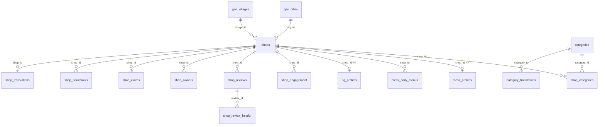
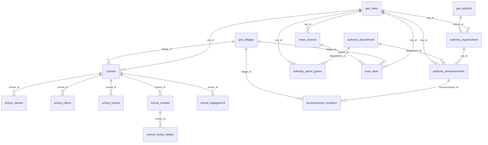
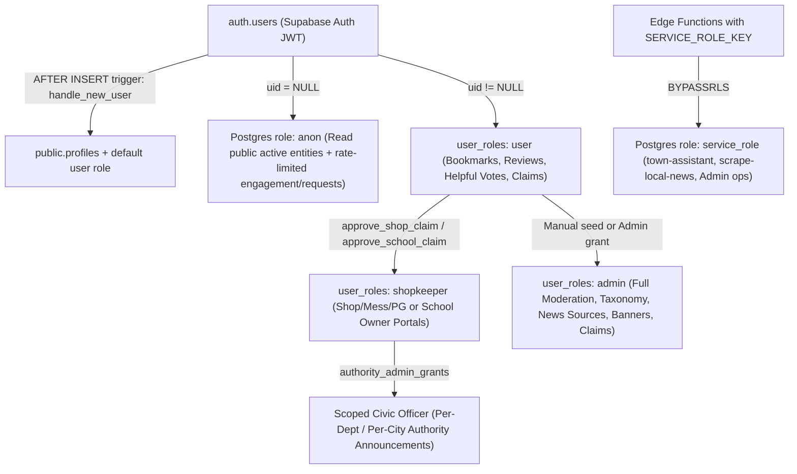
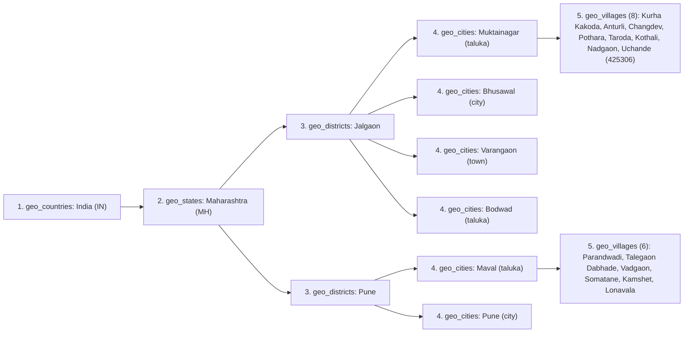

# ApnaLocal / Muktainagar Daily — Database Schema, Security & Geographical Hierarchy Report

**Scope:** Authoritative architectural reference covering all **42 live domain tables**, **4 security-invoker views**, **2 materialized views**, **4 storage buckets**, triggers, RPCs, PostgreSQL/PostgREST RBAC roles & RLS permissions, the **5-level geographical hierarchy**, and a verified **schema drift & documentation discrepancy ledger**.

**Source Reconciliation Note:** As documented in [`src/integrations/supabase/external-types.ts`](../src/integrations/supabase/external-types.ts), runtime traffic connects to external Supabase project **`fhlaqgzensagjangkpop`**, whereas one legacy Lovable Cloud scaffold migration (`supabase/migrations/20260515050933_53e333df-28f4-45fa-b00a-2b7a8e49feaa.sql` — 15 unrelated e-commerce scaffold tables such as `brands`, `products`, `services`, `offers`, `festival_themes`) sits in the migrations directory without participating in the production runtime schema. Ground truth below synthesizes [`supabase/master_schema.sql`](../supabase/master_schema.sql) alongside chronological `supabase/migrations/*.sql` and `docs/patches/*.sql` scripts.

---

## 1. Schema Inventory Overview

| Category | Count | Key Objects |
|---|---:|---|
| **Extensions** | 3 | `uuid-ossp`, `pg_trgm`, `unaccent` |
| **Live Domain Tables** | 42 | 5 Geo, 7 Core Directory & Reviews, 7 Education Portal, 5 Living & Transit, 2 Local News, 5 Essential Services, 5 Auth/Ownership/Profiles, 4 i18n/Cache, 2 Banners & Integrations |
| **Security-Invoker Views** | 4 | `shops_with_claim`, `profiles_public`, `shops_list_public`, `shops_search_public` |
| **Materialized Views** | 2 | `category_shop_counts` (`public`), `shop_engagement_stats` (`private` in hardened migration / `public` in `master_schema.sql`) |
| **Storage Buckets** | 4 | `shop-images` (mixed public + private `claims/`), `school-images`, `request-images`, `banner-images` |
| **Anti-Abuse Rate-Limit Triggers** | 7 | `shop_claims`, `shop_requests`, `shop_reviews`, `shop_engagement`, `school_claims`, `school_reviews`, `school_engagement` |

---

## 2. Domain-by-Domain Entity-Relationship Architecture

### 2.1 Core Directory, Living Verticals & Reviews

### 2.2 Education Portal, Essential Services & Local News

---

## 3. Authoritative Table, View, Trigger & RPC Catalog

### 3.1 Geographical Hierarchy Tables (5)

| Table | Primary Key & Unique Constraints | Foreign Keys | Key Columns & Defaults |
|---|---|---|---|
| `geo_countries` | Patch `2026-10-24`: `code TEXT PK` (`'IN'`). *(See §7 Drift: `master_schema.sql` shows `id UUID PK, code UNIQUE`)* | — | `code`, `name`, `name_mr`, `is_active DEFAULT true`, `created_at` |
| `geo_states` | `id UUID PK`; `code TEXT UNIQUE` (`'MH'`) | Patch: `country_code -> geo_countries(code) CASCADE`; `master_schema`: `country_id -> geo_countries(id)` | `code`, `name`, `name_mr`, `is_active DEFAULT true`, `created_at` |
| `geo_districts` | `id UUID PK`; `uq_geo_districts_state_slug(state_id, slug)` | `state_id -> geo_states(id) CASCADE` | `slug` (`'jalgaon'`, `'pune'`), `name`, `name_mr`, `is_active` |
| `geo_cities` | `id UUID PK`; `uq_geo_cities_district_slug(district_id, slug)` | `district_id -> geo_districts(id) CASCADE` | `slug`, `name`, `name_mr`, `type CHECK('taluka','city','town','panchayat')`, `latitude`, `longitude`, `is_active`, `sort_order` |
| `geo_villages` | `id UUID PK`; `uq_geo_villages_city_slug(city_id, slug)` | `city_id -> geo_cities(id) CASCADE` | `slug`, `name`, `name_mr`, `pincode`, `latitude`, `longitude`, `is_active`, `sort_order` |

### 3.2 Core Directory & Community Reviews Tables (7)

| Table | Constraints, Unique Indexes & FKs | Triggers |
|---|---|---|
| `categories` | `id UUID PK`, `name`, `icon DEFAULT '🏪'`, `sort_order`, `is_active`, `updated_at` | `set_updated_at()`, MV refresh trigger for `category_shop_counts` |
| `shops` | `id PK`, `slug UNIQUE`; FKs `category_id -> categories` (legacy/deprecated), `state_id -> geo_states`, `district_id -> geo_districts`, `city_id -> geo_cities`, `village_id -> geo_villages`; `photos TEXT[]`, `amenities TEXT[]`, `image_checked_at`, `image_broken_at` (partial index `idx_shops_image_broken_at`) | `trg_shop_slug` (`BEFORE INSERT OR UPDATE OF name` -> `set_shop_slug()`), `trg_shops_owner_column_guard` (`BEFORE UPDATE` blocks non-admins changing `is_verified`, `is_active`, `slug`, `category_id`), `set_updated_at()`, MV refresh trigger |
| `shop_categories` | `id PK`, `UNIQUE(shop_id, category_id)`; `shop_id -> shops CASCADE`, `category_id -> categories CASCADE` | MV refresh trigger (`category_shop_counts`) |
| `shop_engagement` | `id PK`, `shop_id -> shops CASCADE`; Patch `2026-07-08`: `CHECK(event_type IN ('call','whatsapp','maps'))` *(master_schema lists `'directions','share','view'` too)* | `shop_engagement_rate_limit` (`BEFORE INSERT`, `20` anon events / `(shop_id, event_type)` / min) |
| `shop_requests` | `id PK`, `entity_type CHECK('shop','mess','pg','school')`, `status CHECK('pending','approved','rejected')`, `maps_link CHECK(NULL \| ^https?://)`, `photos TEXT[]`, `meta JSONB`, `amenities TEXT[]`; FKs `state_id`, `district_id`, `city_id`, `village_id`, `submitter_user_id -> auth.users` | `shop_requests_rate_limit` (`BEFORE INSERT`: v2 enforces max `3` / phone / 2h + `150` anon global / hr), `set_updated_at()` |
| `shop_reviews` | Migration `20260723114744`: `id PK`, `UNIQUE(shop_id, user_id)`, `rating SMALLINT CHECK(1..5)`, `body <= 2000`, `helpful_count` *(master_schema names legacy table `reviews`)* | Anti-spam rate limit trigger (`5` / user / 24h) + `set_updated_at()` |
| `shop_review_helpful` | Composite `PK(review_id, user_id)`; `review_id -> shop_reviews CASCADE`, `user_id -> auth.users CASCADE` | Insert/Delete sync trigger on `shop_reviews.helpful_count` |

### 3.3 Education Portal & School Owner Hub Tables (7) (`20261112000000`)

| Table | Constraints, Unique Indexes & FKs | Triggers |
|---|---|---|
| `schools` | `id PK`, partial unique index `idx_schools_slug_unique(slug) WHERE slug IS NOT NULL`; FKs `state_id`, `district_id`, `city_id`, `village_id`; CHECKs on `school_type` (8 values), `medium` (7 values), `management_type` (5 values), `gender_type`, `admission_status`, `fee_tier`, HTTP(S) URLs (`website`, `admission_url`, `prospectus_url`); arrays `mediums`, `streams`, `facilities`, `scholarships`, `required_documents`, `transport_villages`, `coaching_focus`, `photos`; `is_verified`, `is_claimed`, `udise_aishe_code`, `image_checked_at`, `image_broken_at` | `trg_schools_auto_slug` (`BEFORE INSERT`), `trg_protect_school_admin_columns` (`BEFORE UPDATE` blocks non-admins editing `is_active`, `is_verified`, `is_claimed`, geo FKs, `slug`, or `udise_aishe_code` when `OLD.is_verified = true`), `set_updated_at()` |
| `school_owners` | `id PK`, `UNIQUE(school_id, user_id)`, `REPLICA IDENTITY FULL`; `school_id -> schools CASCADE`, `user_id -> auth.users CASCADE`, `assigned_by -> auth.users SET NULL` | `trg_school_owners_sync_claimed` (`AFTER INSERT OR DELETE` updates `schools.is_claimed`) |
| `school_claims` | `id PK`, `school_id -> schools CASCADE`, `user_id -> auth.users CASCADE`, `status CHECK('pending','approved','rejected')`, `proof_type CHECK(8 values)` | `trg_school_claims_rate_limit` (`BEFORE INSERT`: 1 pending/(user,school), 5 pending/user), `trg_school_claims_updated_at` |
| `school_notices` | `id PK`, `school_id -> schools CASCADE`, `title CHECK(2..160)`, `body CHECK(<=1500)`, `category CHECK(7 values)`, `attachment_url CHECK(https?)`, `expires_at` | `trg_school_notices_updated_at` |
| `school_reviews` | `id PK`, `UNIQUE(school_id, user_id)`, `rating SMALLINT CHECK(1..5)`, `body <= 2000`, `helpful_count` | `trg_school_reviews_rate_limit` (`5` / 24h; admins exempt), `trg_school_reviews_updated_at` |
| `school_review_helpful` | Composite `PK(review_id, user_id)`; `review_id -> school_reviews CASCADE`, `user_id -> auth.users CASCADE` | `trg_school_review_helpful_ins` / `_del` -> `school_review_helpful_sync()` |
| `school_engagement` | `id PK`, `school_id -> schools CASCADE`, `event_type CHECK('call','whatsapp','website','maps','prospectus')` | `trg_school_engagement_rate_limit` (`20` anon events / `(school_id, event_type)` / min) |

### 3.4 Living Verticals & Transit Tables (5)

| Table | Keys, Constraints & Business Rules |
|---|---|
| `mess_profiles` | `shop_id UUID PK -> shops(id) CASCADE` (strict 1:1 extension); `mess_type CHECK('pure_veg','veg_nonveg','jain_available')`, `monthly_rate`, `single_thali_rate`, `tiffin_delivery`, `lunch_timing`, `dinner_timing`, `sunday_feast`. Trigger: `trg_mess_profiles_updated_at`. |
| `mess_daily_menus` | `id PK`, `shop_id -> shops(id) CASCADE`, `CONSTRAINT mess_menu_shop_date_unique UNIQUE(shop_id, menu_date)`, `CONSTRAINT mess_menu_has_content` (at least one of `lunch_text`, `dinner_text`, `photo_url` non-blank). **Convention:** `menu_date = '1970-01-01'` (`REGULAR_MENU_DATE` in `livingService.ts`) stores serialized JSON fixed menu cards outside active daily feeds (`>= '2020-01-01'`). |
| `pg_profiles` | `shop_id UUID PK -> shops(id) CASCADE` (strict 1:1 extension); `gender CHECK('boys','girls','both')`, `occupancy_target CHECK('students','professionals','any')`, `total_beds >= 0`, `available_beds >= 0`, `deposit_amount`, `notice_period_days DEFAULT 30`, `gate_closing_time`, `food_included`, `amenities TEXT[]`, `sharing_rates JSONB` (`1_sharing..4_sharing`, `rooms`), `vacancies_updated_at`. Trigger: `trg_pg_profiles_updated_at`. |
| `bus_timetable` | `id PK`, `city_id -> geo_cities(id) SET NULL`, `destination`, `destination_mr`, `depot`, `departure_times TEXT[]` (array, NOT scalar `departure_time`), `via_stops TEXT[]`, `bus_type CHECK('ordinary','express','semi_luxury','shivshahi','other')`, `platform_number`, `notes`, `is_active`, `sort_order`. |
| `bus_stand_info` | `city_id -> geo_cities(id) CASCADE`; Patch `2026-10-24` added `city_id`, `uq_bus_stand_info_city UNIQUE(city_id)`, and ran `DROP CONSTRAINT IF EXISTS bus_stand_info_id_check` (note: original `2026-06-27` patch named the constraint `bus_stand_info_single_row`). *(See §7 Drift regarding constraint name and `notes` vs `address`/`maps_url` columns).* |

### 3.5 Local News & Aggregation Tables (2) (`20261111000000`)

| Table | Keys, Constraints & Indexes | Triggers |
|---|---|---|
| `news_sources` | `id PK`, `city_id -> geo_cities(id) CASCADE`, `source_type CHECK('rss','webpage')`, `language CHECK('mr','en','hi')`, `category_default CHECK(7 categories)`, `is_active`, `last_scraped_at`, `last_status`, `uq_news_sources_city_url UNIQUE(city_id, url)` | `trg_news_sources_updated_at` |
| `local_news` | `id PK`, `city_id -> geo_cities(id) CASCADE`, `village_id -> geo_villages(id) SET NULL`, `source_id -> news_sources(id) SET NULL`, `category CHECK(7 categories)`, `language CHECK('mr','en','hi')`, `published_at`, `scraped_at`, `is_pinned`, `is_active`, `uq_local_news_city_source_url UNIQUE(city_id, source_url)`; index `idx_local_news_city_feed(city_id, is_active, is_pinned DESC, published_at DESC)` | `trg_local_news_updated_at` |

### 3.6 Essential Services & Local Authorities Tables (5) (`2026-11-08`)

| Table | Keys, Constraints & Multi-Tenant Design |
|---|---|
| `authority_departments` | `id PK`, `slug UNIQUE` (`'water'`, `'electricity'`, `'municipal'`), `name`, `name_mr`, `icon`, `color_theme`, `sort_order`, `is_active`. |
| `authority_organizations` | `id PK`, `department_ids UUID[]` (denormalized multi-department membership), `city_id -> geo_cities CASCADE`, `district_id -> geo_districts SET NULL`, `helpline_phone`, `emergency_phone`, `whatsapp_number`, `visiting_hours`, `key_contacts JSONB`, `is_demo`, `is_verified`, `is_active`. |
| `authority_announcements` | `id PK`, `org_id -> authority_organizations CASCADE`, `department_id -> authority_departments CASCADE`, `city_id -> geo_cities CASCADE`, `category CHECK('interruption','maintenance','emergency','notice','advisory')`, `priority CHECK('low','medium','high','critical')`, `status CHECK('draft','scheduled','active','completed','cancelled')`, `start_time`, `end_time`, `published_at`, `media_urls TEXT[]`, `is_demo`, `created_by -> auth.users SET NULL`. |
| `announcement_locations` | `id PK`, `announcement_id -> authority_announcements CASCADE`, `city_id -> geo_cities CASCADE`, `village_id -> geo_villages CASCADE`, `area_text`. Maps one outage/notice to multiple villages/wards. |
| `authority_admin_grants` | `id PK`, `user_id -> auth.users CASCADE`, `department_id -> authority_departments CASCADE` (`NULL` = all depts), `city_id -> geo_cities CASCADE` (`NULL` = all towns), `district_id -> geo_districts CASCADE`, `can_publish`, `can_edit`, `is_active`. *(Note §7 signature drift vs `master_schema.sql`)* |

### 3.7 Auth, Ownership, i18n & Integrations Tables (11)

| Group | Table | Key Schema & Constraints |
|---|---|---|
| **Auth / Profiles (5)** | `profiles` | `id PK -> auth.users CASCADE`, `full_name UNIQUE` (`@username`), `email`, `locale CHECK('en','mr')`, `phone`, `birth_date`, `gender CHECK('male','female','other','prefer_not_to_say')` (`2026-06-27` patch), geo FKs (`state_id`, `district_id`, `city_id`, `village_id`), `full_name_changed_at`. Trigger `trg_profiles_lock_username` enforces one-time username change. Trigger `on_auth_user_created` (`handle_new_user()`) auto-provisions `profiles` + default `'user'` row in `user_roles`. |
| | `user_roles` | `id PK`, `user_id -> auth.users CASCADE`, `role public.app_role` (`'admin'`, `'shopkeeper'`, `'user'`), `UNIQUE(user_id, role)`. |
| | `shop_owners` | `id PK`, `shop_id -> shops CASCADE`, `user_id -> auth.users CASCADE`, `UNIQUE(shop_id, user_id)`, `REPLICA IDENTITY FULL`. |
| | `shop_claims` | `id PK`, `shop_id -> shops CASCADE`, `user_id -> auth.users CASCADE`, `status CHECK('pending','approved','rejected')`, `proof_type CHECK(5 types)`, `proof_image_path`. Trigger `trg_shop_claims_limit` (`1` pending/(user,shop), `3` / 24h / shop, `3` / 1h / user). |
| | `shop_bookmarks` | `id PK`, `user_id -> auth.users CASCADE`, `shop_id -> shops CASCADE`, `UNIQUE(user_id, shop_id)`. |
| **i18n / Cache (4)** | `shop_translations` | `id PK`, `shop_id -> shops CASCADE`, `locale CHECK('mr')`, `UNIQUE(shop_id, locale)`. |
| | `category_translations` | `id PK`, `category_id -> categories CASCADE`, `locale CHECK('mr')`, `UNIQUE(category_id, locale)`. |
| | `amenity_translations` | Patch `2026-06-01`: `PK(amenity_key, locale)`, `label`. *(See §7 Drift vs `master_schema.sql`)* |
| | `translation_cache` | `PK(direction, source_text)`, `translated`, `hit_count`, `last_used_at`. Column-level `GRANT UPDATE(hit_count, last_used_at)`. |
| **Ads & MCP (2)** | `banners` | `id PK`, `target_level` (`'global','state','district','city'` in patch vs `'all','district','city'` in `master_schema`), `target_district_id`, `target_city_id`, `city_id` (legacy), `target_url CHECK(https?)`, `placement CHECK(8 values)`, `is_active`, `start_date`, `end_date`, `view_count`, `click_count`, `image_checked_at`, `image_broken_at`. |
| | `mcp_endpoints` | Patch `2026-07-08`: `id PK`, `name`, `url`, `auth_type`, `credential_ref`, `environment`, `notes`, `is_enabled` (locked down to `service_role` / admin only). |

### 3.8 Views, Materialized Views & RPC Catalog

| Object | Kind | Security Mode | Purpose & Notes |
|---|---|---|---|
| `shops_with_claim` | View | `security_invoker = on` | Computes `is_claimed` (`EXISTS` on `shop_owners`) without leaking owner UUIDs. |
| `profiles_public` | View | `security_invoker = on` | Safe `(id, full_name)` public projection used for reviewer attribution. |
| `shops_list_public` | View | `security_invoker = on` | Slim `is_active = true` directory payload (`SELECT` granted to `anon, authenticated`). |
| `shops_search_public` | View | `security_invoker = on` | Lazy fuzzy-search sidecar view (`name`, `keywords`, `area`, `description`, `city_id`). |
| `category_shop_counts` | Materialized View | Direct SELECT **revoked**; served via `get_category_shop_counts()` | Refreshed by triggers on `shops` & `shop_categories`; tracks active shop counts per category. |
| `shop_engagement_stats` | Materialized View | Moved to **`private` schema** (`20260502051619`) | 30-day rolling `call` / `whatsapp` / total aggregates; refreshed via `refresh_engagement_stats()`. |
| `has_role` / `is_admin` / `is_shop_owner` / `is_school_owner` | SQL/PLpgSQL Functions | `SECURITY DEFINER`, `SET search_path = public` | RLS predicate helpers preventing recursive policy evaluation. |
| `check_authority_admin_access` | PLpgSQL Function | `SECURITY DEFINER`, `STABLE` | Evaluates super-admin OR active `authority_admin_grants` (`NULL` dept/city wildcard support). |
| `approve_shop_claim` / `reject_shop_claim` / `assign_shop_owner` / `revoke_shop_owner` | Admin RPCs | `SECURITY DEFINER`; `PUBLIC/anon` REVOKED | Mutates claims/owners/roles (`revoke_shop_owner` checks `school_owners` too so dual owners keep `'shopkeeper'`). |
| `approve_school_claim` / `reject_school_claim` / `assign_school_owner` / `revoke_school_owner` | Admin RPCs | `SECURITY DEFINER`; `PUBLIC/anon` REVOKED | Locks `school_claims FOR UPDATE`, updates `school_owners`, assigns `'shopkeeper'` role cleanly. |
| `get_shop_rating` / `get_school_rating` / `get_schools_rating_summary` | Aggregate RPCs | `STABLE`; granted `anon, authenticated` | Computes `(average, count, d5..d1)` or batch list summaries. |
| `get_shops_page` | Paginated Search RPC | `STABLE`, bounded `p_limit 1..50`, search `<= 100` chars | **Warning (§7 Drift):** exists in both 5-arg and 7-arg (`p_city_id, p_village_id`) overloads! |
| `increment_banner_view` / `increment_banner_click` / `reorder_banners` | Banner RPCs | `SECURITY DEFINER` | View/click increments open to public; `reorder_banners` admin-only (`PUBLIC/anon` revoked). |
| `get_system_health_snapshot` | Admin Diagnostics RPC | `SECURITY DEFINER`, `42501` if non-admin | Inspects `image_broken_at` schema state, `storage.objects` root policy (`distinct from`), MV drift, and pending queue counts. |

---

## 4. Roles, Permissions & Security Architecture

### 4.1 PostgREST Two-Layer Access Model

Every API call through PostgREST must satisfy **both** layers unless executed with `service_role` (which carries `BYPASSRLS`):
1. **Layer 1 — SQL Table/Column `GRANT`s**: Explicit `GRANT SELECT / INSERT / UPDATE / DELETE` (or column-level `GRANT UPDATE(col1, col2)`) to `anon` and/or `authenticated`. Notice [`2026-11-09_security_hardening_v3.sql:16-31`](../docs/patches/2026-11-09_security_hardening_v3.sql#L16-L31) explicitly patched missing PostgREST `GRANT`s on `authority_*` tables where RLS policies existed without table grants (`SEC-01`).
2. **Layer 2 — Row-Level Security (`ENABLE ROW LEVEL SECURITY`) Policies**: Applied to all 42 domain tables (with explicit `FOR DELETE` added on `mess_profiles`, `pg_profiles`, `mess_daily_menus` under `SEC-02`).

### 4.2 Application Role Hierarchy (`public.app_role`) & Auth Bootstrap

- **Database Bootstrap**: Initial admin grant hardcoded for `harshking5305@gmail.com` in `20260501151900:348` and `20261025000000:73`.
- **Client UI Role Resolution (`src/hooks/useAuth.tsx:43, 175-189`)**: `ROLE_RANK = { admin: 3, shopkeeper: 2, user: 1 }` picks the highest rank from `user_roles`.
- **DEV-Only Client Bypass (`useAuth.tsx:175-182`)**: In Vite dev builds (`import.meta.env.DEV`), `localStorage.dev_admin === 'true'` or `admin` in email promotes UI `isAdmin` to `true`, allowing route inspection of `/admin` **on the frontend only** — PostgreSQL RLS still rejects writes unless the JWT's real `auth.uid()` possesses `'admin'` in `public.user_roles`.
- **Server-Side Scoped Delegation (`authority_admin_grants`)**: `check_authority_admin_access(_user_id, _department_id, _city_id)` grants non-super-admins scoped publishing permissions where `department_id IS NULL` acts as an all-departments wildcard and `city_id IS NULL` acts as an all-cities wildcard (`is_active = true`).

### 4.3 Ownership Workflows & Column-Level Escalation Guards

- **Shop Ownership**: Managed via `shop_owners` + `shop_claims` + `approve_shop_claim()`. Before `UPDATE` on `shops`, trigger `shops_owner_column_guard` silently resets `is_verified`, `is_active`, `slug`, and `category_id` back to `OLD.*` values for non-admins.
- **School Ownership**: Managed via `school_owners` + `school_claims` + `approve_school_claim()`. Trigger `sync_school_is_claimed` maintains `schools.is_claimed` automatically so `school_owners` UUIDs stay private. Before `UPDATE` on `schools`, trigger `protect_school_admin_columns` raises SQLSTATE `42501` if a non-admin changes `is_active`, `is_verified`, `is_claimed`, `city_id`, `district_id`, `state_id`, `slug`, or `udise_aishe_code` (once `OLD.is_verified = true`).
- **Dual-Owner Protection (`20261112000000:510-533`)**: Both `revoke_school_owner()` and `revoke_shop_owner()` query **both** `shop_owners` and `school_owners` before deleting `'shopkeeper'` from `user_roles`.
- **Cache Integrity (`2026-07-05_security_hardening_fix.sql:60-61`)**: `REVOKE UPDATE ON public.translation_cache FROM anon, authenticated; GRANT UPDATE (hit_count, last_used_at) ...` stops anonymous clients from poisoning cached Marathi translations while still allowing hit-counter bumps.

### 4.4 Anti-Abuse Rate-Limit Triggers (7 Surfaces)

| Trigger Name | Table | Scope | Enforced Quota | Bypass |
|---|---|---|---|---|
| `trg_shop_claims_limit` | `shop_claims` | Authenticated | Max `1` pending/(user,shop), `3`/24h/shop, `3`/1h/user | `admin` |
| `shop_requests_rate_limit` | `shop_requests` | Anonymous (`submitter_user_id IS NULL`) | `v2`: max `3` / `phone` / 2h + `150` / hr global | Signed-in JWT (`auth.uid() IS NOT NULL`) |
| `shop_engagement_rate_limit` | `shop_engagement` | Anonymous | Max `20` / `(shop_id, event_type)` / minute | Signed-in JWT |
| *Review trigger (`20260723` / `v2`)* | `shop_reviews` | Authenticated | Max `5` reviews / 24h / user | `admin` |
| `trg_school_claims_rate_limit` | `school_claims` | Authenticated | Max `1` pending/(user,school), `5` pending / user | `admin` |
| `trg_school_reviews_rate_limit` | `school_reviews` | Authenticated | Max `5` institute reviews / 24h / user | `admin` |
| `trg_school_engagement_rate_limit` | `school_engagement` | Anonymous | Max `20` / `(school_id, event_type)` / minute | Signed-in JWT |

### 4.5 Permission & RLS Matrix by Domain Group

| Table Group | `anon` | `authenticated` (Citizen) | Owner / Scoped Officer | `admin` |
|---|---|---|---|---|
| `geo_*`, `categories`, `authority_departments`, `category_shop_counts` (via RPC) | `SELECT` | `SELECT` | — | Full (`ALL`) |
| `shops` *(Note §7 RLS drift!)* | `SELECT` *(intended `is_active=true`, drifted to `true` in `20261025`)* | `SELECT` | Update non-protected cols via `is_shop_owner` (`shops_owner_column_guard`) | `ALL` (`INSERT`/`UPDATE`/`DELETE`) |
| `schools` | `SELECT` (`is_active = true`) | `SELECT` (`is_active = true`) | `SELECT` + `UPDATE` own via `is_school_owner` (`protect_school_admin_columns`) | `ALL` |
| `school_notices` | `SELECT` (active notice on active school) | `SELECT` | Full CRUD via `is_school_owner` | `ALL` |
| `mess_profiles`, `mess_daily_menus`, `pg_profiles` | `SELECT` (active shop) | `SELECT` | `INSERT` / `UPDATE` / `DELETE` via `shop_owners` | `ALL` |
| `bus_timetable`, `bus_stand_info`, `banners` | `SELECT` (active / schedule window) | `SELECT` (plus `increment_banner_*` RPC) | — | `ALL` |
| `shop_reviews`, `school_reviews`, `shop_bookmarks` | `SELECT` (reviews only) | `SELECT`, own `INSERT` / `UPDATE` / `DELETE` | Same as user | Moderation / Delete |
| `school_review_helpful` / `shop_review_helpful` | None (school) / Public `SELECT` (shop) | Own `SELECT` / `INSERT` / `DELETE` | — | Own / Moderation |
| `shop_engagement`, `school_engagement` | `INSERT` only (rate-limited, NO `SELECT`) | `INSERT` | `SELECT` own school (`school_engagement`) | `SELECT` all |
| `shop_requests` | `INSERT` only (rate-limited) | `INSERT`, `SELECT` own | — | Full (`ALL`) |
| `shop_claims`, `school_claims`, `shop_owners`, `school_owners` | None | Claims: `INSERT` (`status='pending'`) + own `SELECT`; Owners: own `SELECT` | Owner `SELECT` own | `ALL` + RPCs (`approve_*`, `assign_*`, `revoke_*`) |
| `authority_organizations` | `SELECT` | `SELECT` | `UPDATE` via org/admin | `ALL` |
| `authority_announcements`, `announcement_locations` | `SELECT` (`active`, `completed`, or `scheduled & published_at <= now()`) | `SELECT` | Scoped CRUD via `check_authority_admin_access` | `ALL` |
| `authority_admin_grants` | None | Own `SELECT` | — | `ALL` |
| `local_news` / `news_sources` | `local_news`: `SELECT` (`is_active=true`); `news_sources`: None | `local_news`: `SELECT` | — | `ALL` on both |
| `translation_cache` | `SELECT`, `INSERT`, col-scoped `UPDATE(hit_count, last_used_at)` | Same as `anon` | — | `ALL` |
| `mcp_endpoints` | None | **Revoked** (`2026-11-09` `SEC-05`) | — | `service_role` / `admin` only |

---

## 5. Five-Level Geographical Hierarchy & Multi-Town Scoping

### 5.1 Administrative Tree & Pre-Seeded Coordinates (`geoService.ts` + `2026-10-24` / `2026-10-25`)

[`src/lib/geo/geoService.ts`](../src/lib/geo/geoService.ts) embeds exact offline UUID constants matching Supabase seeds (`Muktainagar: 644b68eb-472c-40d3-9f83-c7d26e121498`, `Maval: 98aba7d0-ba7f-443f-a9bc-2f3079b06fe6`, `Parandwadi: eea5f1fb-04a7-4f53-b3a4-497a781324b3`) so town selection never stalls on network loss.

### 5.2 Five Data-Scoping Patterns Across Tables

1. **Direct Hierarchical FKs (`state_id`, `district_id`, `city_id`, `village_id`)**: `shops`, `schools`, `shop_requests`, `profiles`.
2. **Direct Town-Scoped (`city_id` mandatory / nullable + optional `village_id`)**: `bus_timetable`, `bus_stand_info` (per-city UNIQUE), `news_sources`, `local_news`, `authority_organizations` (`city_id` + `district_id`), `authority_announcements`.
3. **Inherited Parent-Entity Scoping**: `mess_profiles`, `mess_daily_menus`, and `pg_profiles` store only `shop_id -> shops(id)`; town/village membership resolves by joining `shops`. Likewise `school_notices`, `school_reviews`, and `school_engagement` inherit town scope via `school_id -> schools(id)`.
4. **Multi-Location Junction Scoping**: `announcement_locations` links a single `authority_announcements` row to many `geo_villages` or text wards (`area_text`) within a `city_id`.
5. **Hierarchical Ad Targeting (`banners`)**: `target_level` + `target_district_id` + `target_city_id` allow district-wide, state/global, or single-town banner impressions alongside legacy `city_id`.

### 5.3 Runtime Resolution & Muktainagar Legacy-Null Rule (`CityProvider`)

In [`src/hooks/useCity.tsx`](../src/hooks/useCity.tsx), city precedence runs top-down:
1. First URL path segment `/:citySlug` (`pathCitySlug`) — wins and syncs back into `localStorage['md.selected_city_slug']`.
2. `localStorage['md.selected_city_slug']` (paired with `'md.selected_village_slug'`).
3. Signed-in user's `profiles.city_id` -> `geo_cities(slug)` (only when no URL city prefix is active).
4. Default fallback `'muktainagar'`.

**Legacy Null-City Union vs Strict City Scoping:** Because historical pre-migration rows in `shops`, `schools`, and `bus_timetable` were occasionally created without `city_id`, queries in [`town-assistant/index.ts:441-443`](../supabase/functions/town-assistant/index.ts#L441-L443), [`assistantService.ts:264-280`](../src/lib/assistant/assistantService.ts#L264-L280), [`schoolsRepo.ts`](../src/lib/repos/schoolsRepo.ts), and [`livingService.ts`](../src/lib/living/livingService.ts) apply `.or('city_id.eq.<id>,city_id.is.null')` exclusively when `citySlug === 'muktainagar'`, while strict `city_id = <id>` applies everywhere else and on all newer modules (`local_news`, `authority_*`). Village selection (`currentVillage`) acts as a **soft priority ranker** (moving village-matched entities and bus-covered schools to the top) rather than a strict exclusion filter.

---

## 6. Storage Subsystems (`storage.objects`)

| Bucket | Public Read? | Folder / Path Structure (`src/lib/storageNaming.ts`) | Upload / Write RLS Rules & Critical Fix |
|---|---|---|---|
| `shop-images` | **Mixed** (Public objects + Private PII subfolder) | Root/slug files + `banners/...`, `menus/...`, private `claims/<user_id>/...` | **Critical Bug Fix (`2026-10-25_v2` & `20261113000000`):** Earlier policy `(storage.foldername(name))[1] <> 'claims'` evaluated to `NULL` (`false`) for root-level files without slashes, hiding shop photos from `.list('')` and causing HTTP `409` duplicate filename collisions. Fixed to **`((storage.foldername(name))[1] IS DISTINCT FROM 'claims')`**. `claims/<user_id>/...` readable only by `auth.uid()::text` owner or `admin`. |
| `school-images` | **Yes** (`public = true`) | School covers & galleries | Public `SELECT`; `admin` (and verified `school_owners` in `20261112`) write/update/delete. |
| `request-images` | **Yes** (`public = true`) | Public 4-step submission photos (`shop_requests`) | Public `SELECT`; `authenticated` upload (`INSERT`); `admin` update/delete (`2026-07-05_bucket_split.sql`). |
| `banner-images` | Bucket configured | Promotional creative assets | Admin-managed promotional creatives (`getStorageBucket` references in `2026-07-05`). |

---

## 7. Schema Drift & Documentation Discrepancies Ledger

Audit across [`supabase/master_schema.sql`](../supabase/master_schema.sql) (stamped `2026-11-09`), `supabase/migrations/*.sql`, `docs/patches/*.sql`, [`docs/DATABASE_REFERENCE.md`](../docs/DATABASE_REFERENCE.md), and application runtime revealed **13 concrete discrepancies** that engineers must account for before editing or deploying migrations:

| # | Area | `master_schema.sql` / Docs State | Actual Migrations / Patches / Code State | Operational Impact |
|---:|---|---|---|---|
| **1** | **Geo PKs (`geo_countries`, `geo_states`)** | `master_schema.sql:24-43` & `DATABASE_REFERENCE.md:63-64` define `geo_countries(id UUID PK, code UNIQUE)` and `geo_states.country_id UUID FK`. | `2026-10-24_multi_town_hierarchy.sql:17-33` created `geo_countries(code TEXT PK)` and `geo_states(country_code TEXT FK -> geo_countries.code)`. | Re-running `master_schema.sql` against a live DB initialized from `2026-10-24` or writing `country_id` joins would fail on column mismatch. |
| **2** | **`schools` + 6 Education Tables (`20261112`) & `local_news` (`20261111`)** | **Completely absent** from `master_schema.sql` (last updated `2026-11-09`); `master_schema.sql:224` shows only the legacy 20-column `schools` table. | `20261111` adds `news_sources` + `local_news`; `20261112` adds ~30 structured columns on `schools` plus `school_owners`, `school_claims`, `school_notices`, `school_reviews`, `school_review_helpful`, `school_engagement`. | `town-assistant/index.ts:445-453` and `search-schools.ts:41-66` had to implement dual `enrichedCols -> legacyCols` query fallbacks to tolerate unmigrated DBs. |
| **3** | **Shop Reviews Table Name** | `master_schema.sql:160, 1005` creates & grants `public.reviews` (`user_name`, no `helpful_count`). | `20260723114744` & `DATABASE_REFERENCE.md` use `public.shop_reviews` (`UNIQUE(shop_id, user_id)`, `body`, `helpful_count`) + `shop_review_helpful`. | `master_schema.sql` grant on `reviews` references an obsolete table name. |
| **4** | **`authority_admin_grants` & RPC Signature Mismatch** | `master_schema.sql:347-355, 883-899` omits `district_id/can_publish/can_edit/is_active`, uses 2-arg `check_authority_admin_access(p_dept_id, p_city_id)`, and policy line `1064` calls 2 args. | `2026-11-08_essential_services_schema.sql:96-145, 188-208` adds those 4 columns and defines **3-arg** `check_authority_admin_access(_user_id, _department_id, _city_id)` checking `is_active = true`. | Mixing `master_schema.sql` with `2026-11-08` creates a 2-arg vs 3-arg function overload or breaks policy calls! |
| **5** | **`get_shops_page()` Function Overload Hazard** | `master_schema.sql:765` & `2026-11-09_v3:73` define **5-arg** `get_shops_page(p_area, p_category, p_search, p_limit, p_offset)` (capped at `<= 50`, `clean_search <= 100`). | `20261025000001_get_shops_page_location_scope.sql:2` created a **7-arg** overload adding `(p_city_id, p_village_id)` **without** the `v3` `LEAST(50)` or 100-char bounds! | In PostgreSQL, differing parameter counts create **two distinct functions** (`CREATE OR REPLACE` does not drop the 7-arg overload), leaving the town-scoped overload missing `SEC-07` DoS bounds! |
| **6** | **`shops` RLS Regression (`20261025000000`)** | `master_schema.sql:1018` restricts SELECT to `is_active = true OR has_role('admin')` and restricts INSERT to admin. | `20261025000000_fix_shop_insert_permissions.sql:56-67` replaced `"Shops are publicly readable"` with **`USING (true)`** (exposing inactive shops publicly via direct `shops` table REST queries) and opened `INSERT` to `has_role('shopkeeper')`! | Client apps rely on manual `.eq('is_active', true)` filters or `shops_list_public` view, whereas direct PostgREST queries against `shops` can see inactive rows unless re-tightened. |
| **7** | **`user_roles.role` Column Type & `has_role` Param** | `master_schema.sql:378, 646` defines `role TEXT CHECK(...)` and `has_role(uid uuid, required_role text)`. | `20260501151900`, `20261025000000:54`, and `external-types.ts:44` use enum `public.app_role` (`has_role(uuid, public.app_role)`). | Type mismatch can generate overload ambiguity if `master_schema.sql` is applied over existing `app_role` DBs. |
| **8** | **`banners.target_level` Values & `image_broken_at`** | `master_schema.sql:488` uses `CHECK(target_level IN ('all','district','city')) DEFAULT 'all'` and omits `image_checked_at/broken_at`. | `2026-10-24:244` uses `('global','state','district','city') DEFAULT 'city'`; `20261113` adds `image_checked_at` & `image_broken_at` to `banners` & `schools`. | Check constraint violations occur if callers insert `'global'` on `'all'`-checked DBs or vice versa. |
| **9** | **`bus_stand_info` Columns & `bus_timetable` MCP Bug** | `master_schema.sql:269` defines `bus_stand_info(id, city_id, phone, address, maps_url)` without `notes`; `2026-06-27` patch created `(id, phone, notes)` with `CONSTRAINT bus_stand_info_single_row CHECK (id = 1)`. | `2026-10-24:226-238` ran `DROP CONSTRAINT IF EXISTS bus_stand_info_id_check` (leaving `bus_stand_info_single_row` untouched if created from `2026-06-27`) and added `uq_bus_stand_info_city`. Meanwhile `src/lib/mcp/tools/get-bus-timetable.ts:25` queries `.order("departure_time")` on `bus_timetable`, which only has `departure_times text[]` + `sort_order`. | Multi-city `bus_stand_info` inserts with `id <> 1` fail if `bus_stand_info_single_row` remains intact; `get_bus_timetable` MCP tool fails at runtime with SQLSTATE `42703`. |
| **10** | **`amenity_translations` Schema Divergence** | `master_schema.sql:474-480` defines `(id UUID PK, key, locale, label)`. | `2026-06-01_i18n.sql:80-85` defines `(amenity_key, locale)` composite PK with **no `id`** and column `amenity_key` (`DATABASE_REFERENCE.md:85` mixes both: lists `id` + `amenity_key`!). | Queries selecting `key` vs `amenity_key` fail depending on which DDL created the table. |
| **11** | **`translation_cache.direction` Separator** | `master_schema.sql:445` uses `DEFAULT 'en-mr'` (hyphen). | `2026-06-05_translation_cache.sql:20` enforces `CHECK(direction IN ('en\|mr', 'mr\|en'))` (pipe). | Inserting `'en-mr'` fails the live check constraint (`\|`). |
| **12** | **`shop_engagement.event_type` Check** | `master_schema.sql:154` allows 6 events (`'call','whatsapp','maps','directions','share','view'`). | `2026-07-08_engagement_event_type_canonical.sql` canonicalizes strictly to `('call','whatsapp','maps')`. | Tracking `'view'` or `'share'` on canonicalized DBs fails CHECK constraint. |
| **13** | **`shop_engagement_stats` Schema, `mcp_endpoints` Cols & `profiles.gender`** | `master_schema.sql:368, 514, 571` puts `shop_engagement_stats` in `public`, sets `mcp_endpoints(url, is_active)`, and limits `profiles.gender` to 3 values. | `20260502051619` moves `shop_engagement_stats` to **`private`** schema; `2026-07-08_mcp_endpoints.sql` adds `auth_type/credential_ref/environment/notes/is_enabled`; `2026-06-27_profile_edit.sql` adds `'prefer_not_to_say'`. | Security hardening moved engagement MV out of exposed Data API schema; `master_schema.sql` still defines it inside `public`. |
