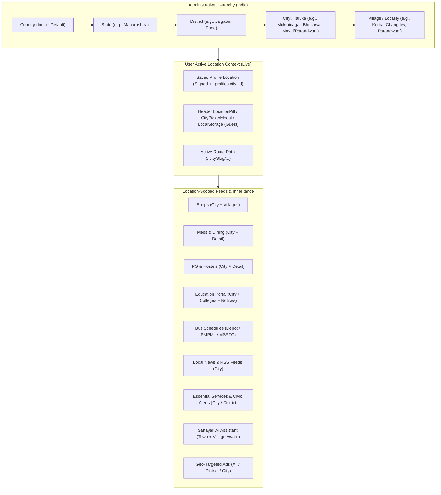

# Multi-Location Platform Architecture & Implementation Status
## From Single-Town Directory to Nationwide Hierarchical Civic Platform

> **Target Platform:** Country (India default) $\to$ State $\to$ District $\to$ City / Taluka $\to$ Village / Ward  
> **Status:** Live in Production (Option B Implemented — Path-Based Multi-Town Routing)  
> **Author:** Antigravity Engineering  
> **Updated:** November 2026  

---

## 1. Executive Summary & Vision

Muktainagar Daily (**ApnaLocal** / `<Town> Daily`) began as a single-town directory for Muktainagar, Maharashtra. The system has transitioned into a **Multi-Region, Multi-Tier Hyperlocal Platform** serving towns, talukas, and satellite villages across Jalgaon and Pune districts (Muktainagar, Bhusawal, Varangaon, Bodwad, Jalgaon, Maval / Parandwadi) while preserving hyperlocal speed, bilingual trust, and mobile-first offline resilience.



---

## 2. Core Architectural Implementation (Live)

### 2.1 The 5-Level Geographic Data Model
India's administrative divisions follow a 5-level hierarchy in `public`:
1. **`geo_countries`:** ISO country (`IN` — India).
2. **`geo_states`:** States + UTs (e.g., `MH` — Maharashtra).
3. **`geo_districts`:** Administrative district (e.g., `jalgaon`, `pune`).
4. **`geo_cities`:** Towns, municipality towns, and rural talukas (e.g., `muktainagar`, `bhusawal`, `varangaon`, `bodwad`, `maval` / `parandwadi`).
5. **`geo_villages`:** Gram panchayats, satellite villages, and rural clusters (e.g., `kurha`, `changdev`, `parandwadi`).

### 2.2 Routing Strategy: Option B (Path-Based Multi-Tenant)
The platform uses **Option B** for SEO clarity and deep-linking:
- **Town URL prefix:** All public discovery routes are prefixed with the active town slug:
  - `/:citySlug` (Home)
  - `/:citySlug/shops` & `/:citySlug/shop/:id`
  - `/:citySlug/mess` & `/:citySlug/mess/:id`
  - `/:citySlug/pg` & `/:citySlug/pg/:id`
  - `/:citySlug/schools` & `/:citySlug/schools/:id`
  - `/:citySlug/bus-timetable`
  - `/:citySlug/services` (Essential Services & Civic Authorities)
  - `/:citySlug/news` (Local News feed)
  - `/:citySlug/sections/:key` (Upcoming vertical placeholders)
- **Dynamic Root Redirect (`RootCityRedirect`):** Accessing `/` reads persisted `localStorage` or user profile town selection, falling back to `muktainagar`, and redirects to `/:activeCitySlug`.
- **Legacy Route Preservation (`LegacyCityRedirect`, `LegacyShopDetailRedirect`, `LegacySchoolDetailRedirect`, `LegacyLivingDetailRedirect`, `LegacyCategoryRedirect`, `LegacySectionRedirect`):** Un-prefixed URLs (`/shops`, `/schools`, `/schools/:id`, `/mess`, `/mess/:id`, `/pg`, `/pg/:id`, `/services`, `/news`, `/bus-timetable`, `/shop/:id`, `/category/:id`, `/sections/:key`) seamlessly redirect to `/:activeCitySlug/...` preserving search params and hashes.
- **Route Guard (`CityRouteGuard`):** Validates `:citySlug` against active cities (`geoService.getCities()`); invalid slugs render `NotFound`.

### 2.3 User Location Context & Dynamic Branding
- **Location Selector Pill (`LocationPill.tsx`):** Rendered in headers to open `CityPickerModal` (fuzzy search, district chips, village chips, GPS nearest-town matching).
- **Dynamic Town Branding (`townConfig.ts`):** Generates localized brand titles (`<Town> Daily` / `<Town_mr> डेली`), SEO metadata, OpenGraph tags, and sitemaps.
- **Data Scoping:** Public feeds, **Sahayak AI (`TownAssistantDrawer`)**, and **MCP tools** (`get_local_news`, `search_schools`, `get_civic_services`) scope data by active `city_id` / `citySlug` (with Muktainagar `city_id.is.null` legacy compatibility where applicable).

---

## 3. Database Schema Status

The geographic hierarchy and entity foreign keys are live across core, living, civic, news, and education tables:

```sql
-- Live Geographic Subsystem Tables
public.geo_countries  -- id, code, name, is_active
public.geo_states     -- id, country_id, code, name, name_mr, is_active
public.geo_districts  -- id, state_id, slug, name, name_mr, is_active
public.geo_cities     -- id, district_id, slug, name, name_mr, type, lat, lng, is_active
public.geo_villages   -- id, city_id, slug, name, name_mr, pincode, lat, lng, is_active
```

### Entity Foreign Key Integration

| Table | Geographic Foreign Keys | Status |
|---|---|---|
| `public.profiles` | `city_id`, `village_id` | **Live** |
| `public.shops` | `state_id`, `district_id`, `city_id`, `village_id` | **Live** |
| `public.mess_profiles` | Inherits location via `shop_id → shops` | **Live** |
| `public.pg_profiles` | Inherits location via `shop_id → shops` | **Live** |
| `public.schools` | `state_id`, `district_id`, `city_id`, `village_id` | **Live** |
| `public.bus_timetable` | `city_id` | **Live** |
| `public.bus_stand_info` | `city_id` | **Live** |
| `public.news_sources` | `city_id` | **Live** |
| `public.local_news` | `city_id`, `village_id` | **Live** |
| `public.authority_organizations` | `district_id`, `city_id` | **Live** |
| `public.authority_announcements` | `city_id` | **Live** |
| `public.announcement_locations` | `city_id`, `village_id` | **Live** |
| `public.authority_admin_grants` | `city_id` | **Live** |
| `public.banners` | `city_id` (legacy), `target_district_id`, `target_city_id` | **Live** |
| `public.shop_requests` | `state_id`, `district_id`, `city_id`, `village_id` | **Live** |

---

## 4. Phase-Wise Implementation Roadmap & Status

| Phase | Description | Status |
|---|---|---|
| **Phase 1: Geo Foundation** | Geographic hierarchy tables, seeds, Muktainagar + Pune/Maval/Parandwadi backfills, indexes, RLS | **Completed & Live** |
| **Phase 2: Client Engine** | `CityProvider`, `useCity`, `LocationPill`, `CityPickerModal`, Profile city sync | **Completed & Live** |
| **Phase 3: Content Scoping** | Scoped queries for Shops, Mess & Dining, PG & Hostels, Schools & Colleges, Bus Timetable, and Ads | **Completed & Live** |
| **Phase 4a: Essential Services & Local News** | Civic Authorities (`/services`), Local News (`news_sources`, `local_news`, `/news`, RSS scraper), Sahayak AI town assistant | **Completed & Live** |
| **Phase 4b: Additional Verticals** | Hospitals, Banks, Lost & Found, Local Jobs | *Planned / Reserved (`SectionComingSoon`)* |
| **Phase 5: Multi-Tenant Branding & URLs** | Path-based routing (`/:citySlug/...`), dynamic branding, modular admin, town-scoped CSV exports | **Completed & Live** |

---

## 5. Architectural Invariants

1. **Town Slug Stability:** Town slugs in `geo_cities` must remain URL-safe lowercase strings (`muktainagar`, `bhusawal`, `bodwad`, `varangaon`, `parandwadi` / `maval`).
2. **Default Town Fallback:** When geolocation is absent and localStorage has no saved selection, the platform resolves `muktainagar` as the seed default.
3. **Legacy URL Support:** Un-scoped bookmarks must never 404; redirect helpers in `src/App.tsx` preserve all route parameters, search queries, and hash fragments.
