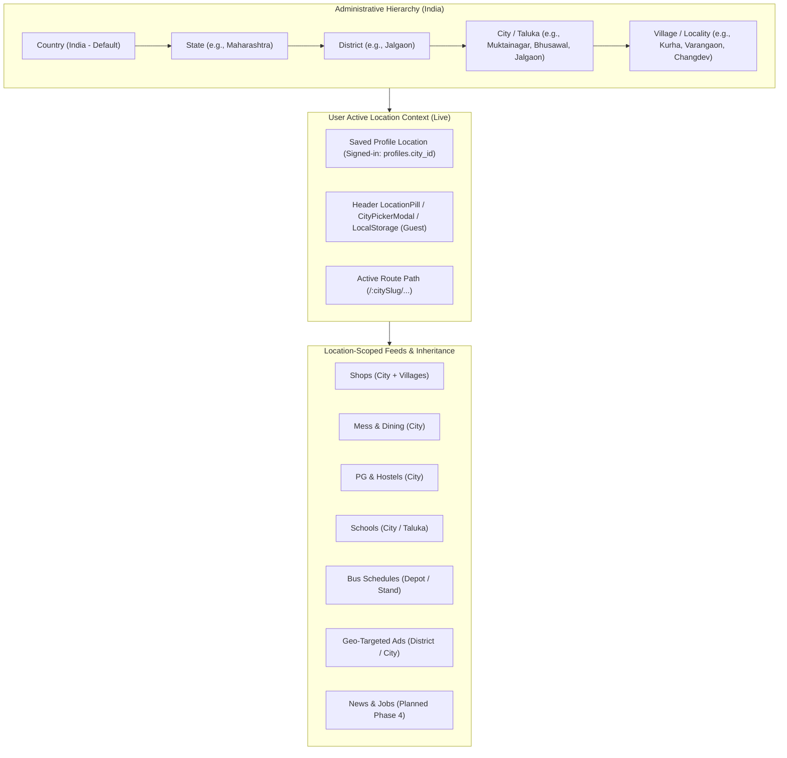

# Multi-Location Platform Architecture & Implementation Status
## From Single-Town Directory to Nationwide Hierarchical Civic Platform

> **Target Platform:** Country (India default) $\to$ State $\to$ District $\to$ City / Taluka $\to$ Village / Ward  
> **Status:** Live in Production (Option B Implemented — Path-Based Multi-Town Routing)  
> **Author:** Antigravity Engineering  
> **Updated:** November 2026  

---

## 1. Executive Summary & Vision

Muktainagar Daily began as a single-town directory for Muktainagar, Maharashtra. The system has successfully transitioned into a **Multi-Region, Multi-Tier Hyperlocal Platform** that serves any village, city, taluka, and district across India, while preserving the hyperlocal speed, bilingual trust, and mobile-first offline resilience of the original design.



---

## 2. Core Architectural Implementation (Live)

### 2.1 The 5-Level Geographic Data Model
India's administrative divisions follow a standard 5-level hierarchy in `public`:
1. **`geo_countries`:** ISO country (`IN` — India).
2. **`geo_states`:** States + UTs (e.g., `MH` — Maharashtra).
3. **`geo_districts`:** Administrative district (e.g., `jalgaon`, `buldhana`).
4. **`geo_cities`:** Urban centers, municipality towns, and rural talukas (e.g., `muktainagar`, `bhusawal`, `bodwad`, `jalgaon`).
5. **`geo_villages`:** Gram panchayats, satellite villages, and rural clusters (e.g., `kurha`, `varangaon`, `anturli`, `changdev`).

### 2.2 Routing Strategy: Option B (Path-Based Multi-Tenant)
The platform adopted **Option B** for maximum SEO authority and deep-linking:
- **Town URL prefix:** All public routes are prefixed with the active town slug: `/:citySlug` (Home), `/:citySlug/shops`, `/:citySlug/shop/:id`, `/:citySlug/mess`, `/:citySlug/pg`, `/:citySlug/schools`, `/:citySlug/bus-timetable`.
- **Dynamic Root Redirect (`RootCityRedirect`):** Accessing `/` automatically reads `localStorage['active_city_slug']` or user profile location and redirects to `/:activeCitySlug`.
- **Legacy Route Preservation (`LegacyCityRedirect`):** Accessing un-scoped legacy paths (`/shops`, `/schools`, `/shop/:slug`) automatically redirects to `/:activeCitySlug/...` preserving all search query parameters.
- **Route Guard (`CityRouteGuard`):** Validates the `:citySlug` parameter against active cities via `geoService.getCities()`. Invalid slugs display an informative 404 state.

### 2.3 User Location Context & Dynamic Branding
- **Location Selector Pill (`LocationPill.tsx`):** Placed prominently in the global header, displaying the active town/village and triggering the `CityPickerModal`.
- **Dynamic Town Branding (`townConfig.ts`):** Automatically computes town-specific branding:
  - Brand Title: `<Town> Daily` / `<Town_mr> डेली` (e.g. `Muktainagar Daily`, `Bhusawal Daily`).
  - Dynamic SEO metadata, OpenGraph tags, and sitemaps.
- **Data Scoping:** Custom hooks (`useShops`, `useMess`, `usePG`, `useSchools`, `useBanners`) query data filtered by the active `city_id` and optional `village_id`.

---

## 3. Database Schema Status

The geographic hierarchy and entity foreign keys are fully migrated and live in production:

```sql
-- Live Geographic Subsystem Tables
public.geo_countries  -- id, code, name, is_active
public.geo_states     -- id, country_id, code, name, name_mr, is_active
public.geo_districts  -- id, state_id, slug, name, name_mr, is_active
public.geo_cities     -- id, district_id, slug, name, name_mr, type, lat, lng, is_active
public.geo_villages   -- id, city_id, slug, name, name_mr, pincode, lat, lng, is_active
```

### Entity Foreign Key Integration

| Table | Geographic Foreign Keys | Status |
|---|---|---|
| `public.profiles` | `state_id`, `district_id`, `city_id`, `village_id` | **Live** |
| `public.shops` | `district_id`, `city_id`, `village_id` | **Live** |
| `public.mess_profiles` | `city_id`, `village_id` | **Live** |
| `public.pg_profiles` | `city_id`, `village_id` | **Live** |
| `public.schools` | `district_id`, `city_id`, `village_id` | **Live** |
| `public.bus_timetable` | `source_city_id`, `dest_city_id` | **Live** |
| `public.bus_stand_info` | `city_id` | **Live** |
| `public.banners` | `city_id`, `district_id` | **Live** |
| `public.shop_requests` | `state_id`, `district_id`, `city_id`, `village_id` | **Live** |

---

## 4. Phase-Wise Implementation Roadmap & Status

| Phase | Description | Status |
|---|---|---|
| **Phase 1: Geo Foundation** | Geographic hierarchy tables, seeds, Muktainagar backfill, indexes, RLS | **Completed & Live** |
| **Phase 2: Client Engine** | `CityProvider`, `useCity`, `LocationPill`, `CityPickerModal`, Profile city sync | **Completed & Live** |
| **Phase 3: Content Scoping** | Scoped queries for Shops, Mess, PG, Schools, Bus, and Ads | **Completed & Live** |
| **Phase 4: New Civic Verticals** | Local News engine & Local Jobs portal (`local_news`, `local_jobs`) | *Planned* |
| **Phase 5: Multi-Tenant Branding & URLs** | Path-based routing (`/:citySlug/...`), dynamic branding, modular admin | **Completed & Live** |

---

## 5. Architectural Invariants

1. **Town Slug Stability:** Town slugs in `geo_cities` must be URL-safe lowercase strings (`muktainagar`, `bhusawal`, `jalgaon`, `bodwad`).
2. **Default Town Fallback:** If geolocation is unavailable and localStorage is clean, the platform falls back to `muktainagar` as the canonical seed town.
3. **Legacy URL Support:** Old non-scoped bookmarks must never 404; `LegacyCityRedirect` in `App.tsx` guarantees persistent backward compatibility.
