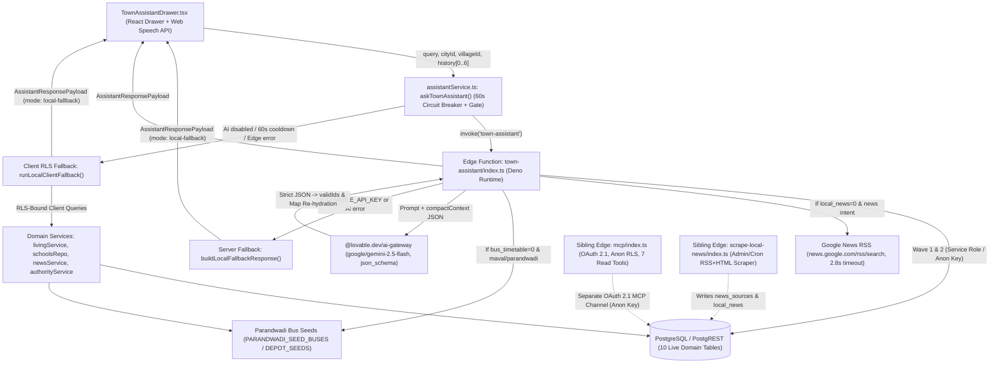
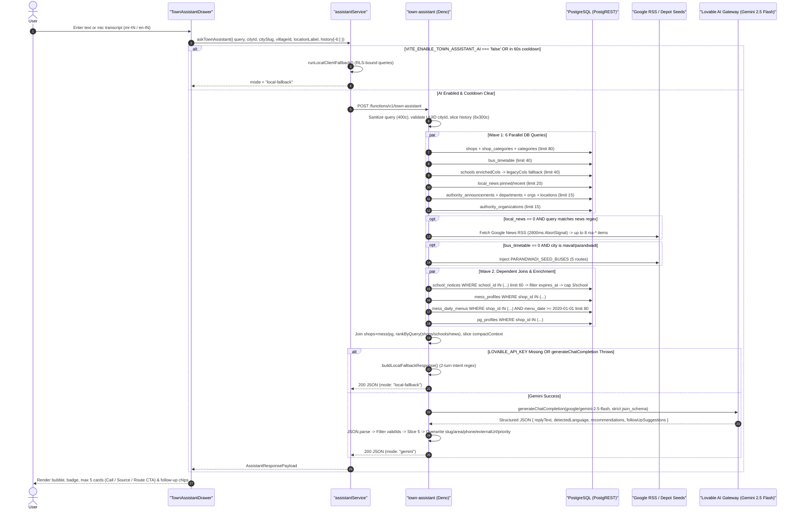

# ApnaLocal Sahayak Architecture & Gemini–Database Interaction Report

**Scope:** Complete end-to-end architecture of **ApnaLocal Sahayak**, tracing every interaction between the React UI, client service/circuit breaker, Supabase Edge Functions, `@lovable.dev/ai-gateway` (`google/gemini-2.5-flash`), PostgreSQL/PostgREST, and external RSS/demo fallbacks — plus a security and reliability audit against sibling Edge Functions (`mcp` and `scrape-local-news`).

**Verification Basis:** Directly audited from runtime source files ([`src/App.tsx`](../src/App.tsx), [`src/components/TownAssistantDrawer.tsx`](../src/components/TownAssistantDrawer.tsx), [`src/lib/assistant/assistantService.ts`](../src/lib/assistant/assistantService.ts), [`supabase/functions/town-assistant/index.ts`](../supabase/functions/town-assistant/index.ts), [`supabase/functions/mcp/index.ts`](../supabase/functions/mcp/index.ts), [`src/lib/mcp/*`](../src/lib/mcp/index.ts), [`supabase/functions/scrape-local-news/index.ts`](../supabase/functions/scrape-local-news/index.ts), and domain services).

---

## 1. Executive Summary & Architectural Paradigm

**Core Design Pattern: Deterministic Server-Side Parallel Context-Hydration RAG (Zero LLM SQL / Zero LLM Tool-Calling)**

Contrary to autonomous SQL-agent or MCP-tool-loop designs, **`google/gemini-2.5-flash` never connects to PostgreSQL, never generates SQL, never invokes MCP tools, and never chooses PostgREST filters**. Instead, the `town-assistant` Edge Function acts as an **authoritative server-side orchestrator** executing an 8-stage pipeline:

1. **Client UI Capture & Hygiene (`TownAssistantDrawer.tsx`)**: Captures text or Web Speech API voice input (`mr-IN` / `en-IN`), attaches current geo context (`cityId`, `citySlug`, `villageId`, `villageName`, `locationLabel`) and up to 6 prior conversation turns.
2. **Client Feature Gate & 60s Circuit Breaker (`assistantService.ts`)**: Checks `VITE_ENABLE_TOWN_ASSISTANT_AI !== 'false'` and an in-memory `60_000 ms` failure cooldown (`edgeFailedAt`) before invoking the Edge Function.
3. **Server Input Sanitization (`town-assistant/index.ts:410-434`)**: Validates `cityId` against `UUID_RE`, truncates `query` to 400 characters, and caps `history` to 6 turns × 300 characters.
4. **Two-Wave Parallel PostgreSQL Hydration (`town-assistant/index.ts:465-563`)**: Queries **10 live PostgreSQL tables** (plus up to 2 conditional external/seed fallbacks) via `SUPABASE_SERVICE_ROLE_KEY || SUPABASE_ANON_KEY`.
5. **In-Memory Joins, Village Boosting & Context Budgeting (`town-assistant/index.ts:565-720`)**: Joins `shops` with `mess_profiles` / `mess_daily_menus` / `pg_profiles`, merges up to 3 active `school_notices` per school, ranks text matches via `rankByQuery()`, and slices the payload to strict item budgets (`compactContext`).
6. **Strict JSON Schema Completion (`town-assistant/index.ts:722-795`)**: Calls `generateChatCompletion` (`model: "google/gemini-2.5-flash"`) with OpenAI-compatible `response_format: { type: "json_schema", strict: true }`.
7. **Anti-Hallucination `validIds` Gate & Authoritative Re-Hydration (`town-assistant/index.ts:796-841`)**: Drops any recommendation whose `id` is not in the pre-fetched server `Set`, caps output at 5 cards, and **overwrites** `slug`, `area`, `phone`, `externalUrl`, and `priority` from authoritative server lookup maps before responding.
8. **Deep-Link Navigation & Sanitized Action Controls (`TownAssistantDrawer.tsx:275-307, 503-570`)**: Routes clicks to entity-specific pages (`/:citySlug/{mess|pg|shop|schools}/:slugOrId` or `/bus-timetable`, `/news`, `/services`) and validates `tel:` / `https://` links.

> [!IMPORTANT]
> **Critical Privilege Boundary:** In production deployments where `SUPABASE_SERVICE_ROLE_KEY` is configured on the Edge Function runtime ([`town-assistant/index.ts:437`](../supabase/functions/town-assistant/index.ts#L437)), **PostgREST queries inside `town-assistant` bypass Postgres Row-Level Security (RLS)**. Publication, active flags (`is_active`), tenant isolation (`city_id`), and expiry predicates (`expires_at`) rely entirely on TypeScript query builders rather than database RLS enforcement. Conversely, Tier-3 client fallback (`runLocalClientFallback`) and the sibling `mcp` Edge Function execute strictly under the `anon` or signed-in `authenticated` JWT and are bound by Postgres RLS.

---

## 2. System Topology



---

## 3. End-to-End 8-Stage Execution Trace

### 3.1 Sequence Trace (Browser → Edge Function → PostgreSQL → Gemini → Browser)



---

### 3.2 Stage-by-Stage Code Mechanics

#### Stage 1: Global UI Mounting, Geo Reset & Input Capture
- **Mount Scope ([`src/App.tsx:286`](../src/App.tsx#L286))**: `<TownAssistantDrawer />` is mounted globally inside `<CityProvider>`, outside individual routes, so state persists across directory navigation unless reset.
- **Hidden Routes ([`TownAssistantDrawer.tsx:113`](../src/components/TownAssistantDrawer.tsx#L113))**: Suppressed (`return null`) on `/admin`, `/auth`, `/reset-password`, and `/oauth` paths.
- **Adaptive FAB Positioning (`L114-123`)**: Floats at `bottom-24 right-4` on detail/saved/owner routes (avoiding sticky bottom action bars), `bottom-20` on `/shops`, and `bottom-5 right-4` elsewhere.
- **Geo Context Reset (`L162-165`)**: A `useEffect` clears `messages` and `input` whenever `currentCity.id` or `currentVillage?.id` changes, preventing stale cross-town context leakage into multi-turn `history`.
- **Voice Capture (`L49-69, 309-350`)**: Uses browser `SpeechRecognition` / `webkitSpeechRecognition` configured to `mr-IN` when UI locale is `'mr'` else `'en-IN'`. Transcript populates the input box (`setInput(transcript)`) rather than auto-submitting.

#### Stage 2: Client Orchestration & 60-Second Circuit Breaker
- Implemented in [`askTownAssistant()`](../src/lib/assistant/assistantService.ts#L825-L863).
- **Kill Switch**: `import.meta.env.VITE_ENABLE_TOWN_ASSISTANT_AI === 'false'` skips the network Edge call immediately.
- **Circuit Breaker**: Module-level `edgeFailedAt` records the timestamp of any Edge error, network failure, or malformed payload (`!data || typeof data.replyText !== 'string'`). Subsequent queries within `EDGE_COOLDOWN_MS = 60_000` route directly to `runLocalClientFallback(params)` so mobile users avoid repeated timeouts.
- **Reset Hook**: `resetAssistantEdgeAvailability()` (`L821-823`) allows tests or manual recovery to clear cooldown.

#### Stage 3: Edge Entrypoint Validation & CORS
- [`town-assistant/index.ts:4-8`](../supabase/functions/town-assistant/index.ts#L4-L8) sets permissive CORS (`Access-Control-Allow-Origin: *`, `POST, OPTIONS`).
- **Sanitization (`L410-434`)**:
  - `query`: trimmed and sliced to **400 chars** (empty -> HTTP `400`).
  - `cityId`: validated strictly against `UUID_RE` (invalid -> HTTP `400`).
  - `citySlug`: lowercased string; used for the Muktainagar legacy-NULL clause and Parandwadi bus seed trigger.
  - `villageId`: validated against `UUID_RE` (`null` if missing/invalid).
  - `history`: filtered for `role IN ('user', 'assistant')` and non-empty string, sliced to the **last 6 turns**, each truncated to **300 chars**.

---

## 4. Detailed Gemini ↔ PostgreSQL Interaction Matrix

Gemini **never** directly queries Postgres. The Edge Function builds Gemini's grounding window across **two sequential query waves** plus optional external/seed enrichment.

### 4.1 Supabase Client Privilege & `applyCityScope`

- **Client Instantiation (`L436-438`)**:
  ```ts
  const supabaseKey = Deno.env.get("SUPABASE_SERVICE_ROLE_KEY") || Deno.env.get("SUPABASE_ANON_KEY")!;
  const sb = createClient(supabaseUrl, supabaseKey);
  ```
- **Town Scoping Helper (`L441-443`)**:
  ```ts
  const isMuktainagar = citySlug === "muktainagar";
  const applyCityScope = (qBuilder: any) =>
    isMuktainagar ? qBuilder.or(`city_id.eq.${cityId},city_id.is.null`) : qBuilder.eq("city_id", cityId);
  ```
  Legacy rows created prior to the `2026-10-24` multi-town migration may carry `city_id IS NULL`. `shops`, `bus_timetable`, and `schools` apply `applyCityScope`; newer modules (`local_news`, `authority_announcements`, `authority_organizations`) require strict `.eq("city_id", cityId)`.

### 4.2 Wave 1 — Six Parallel Base Queries (10 Tables Touched)

Executed concurrently via `Promise.all` wrapped in `safeSelect()` (`L455-511`), ensuring one failing/unmigrated table degrades gracefully to `[]` rather than crashing the entire request:

| # | Primary Table(s) | Joined / Related Tables | City Filter | Active / Status Predicate | Ordering & Limit | Exact Notes (`town-assistant/index.ts`) |
|---|---|---|---|---|---|---|
| **1** | `shops` | `shop_categories`, `categories(name)` | `applyCityScope` (`eq` or `eq \| is.null` for Muktainagar) | `is_active = true` | Unordered · **`limit(80)`** | `L466-470`: Selects `*` plus category names. Fetches **before** ranking or village sorting. |
| **2** | `bus_timetable` | — | `applyCityScope` | `is_active = true` | `sort_order ASC` · **`limit(40)`** | `L471-480`: Selects `id, destination, destination_mr, departure_times, notes`. |
| **3** | `schools` | — | `applyCityScope` | `is_active = true` | Unordered · **`limit(40)`** | `L445-453`: Runs `fetchSchoolsWithFallback()`: tries **28 enriched columns** (`20261112`), falls back to **10 legacy columns** on any error. |
| **4** | `local_news` | — | Strict `.eq("city_id", cityId)` | `is_active = true` | `is_pinned DESC, published_at DESC` · **`limit(20)`** | `L482-491`: Fetches pre-scraped or admin-curated headlines. |
| **5** | `authority_announcements` | `authority_departments`, `authority_organizations`, `announcement_locations` | Strict `.eq("city_id", cityId)` | `.in("status", ["active", "scheduled"])` | `published_at DESC` · **`limit(15)`** | `L492-502`: Embeds department `name/slug`, org `helpline_phone/emergency_phone`, and affected `area_text/village_id`. |
| **6** | `authority_organizations` | — | Strict `.eq("city_id", cityId)` | `is_active = true` | Unordered · **`limit(15)`** | `L503-510`: Provides directory helpline/visiting hours even when no outage alert exists. |

#### Conditional External & Built-in Seed Fallbacks (Between Wave 1 & Wave 2)
1. **Google News RSS Fallback (`L129-167, 514-519`)**:
   - Triggered **only** if `newsDbData.length === 0` **AND** `query` matches `/news|headline|batmya|samachar|बातम्या|ताज्या|वृत्त/i`.
   - Fetches `https://news.google.com/rss/search?q=<cityName>+Maharashtra+when:14d&hl=mr&gl=IN&ceid=IN:mr` with `AbortSignal.timeout(2800)`.
   - Parses up to **8** `<item>` blocks via regex, generating synthetic IDs `rss-<cityId.slice(0,8)>-<idx>`. (Safe to click because `externalUrl` receives `source_url`, while drawer click opens `/:citySlug/news` or source link.)
2. **Parandwadi Bus Seed Injection (`L35-71, 631-632`)**:
   - Triggered if `busesData.length === 0` AND (`citySlug === "maval"` OR `/parandwadi|maval/i.test(locationLabel)`).
   - Injects 5 hardcoded MSRTC/PMPML/Shuttle routes (`parandwadi-seed-1` through `parandwadi-seed-5`).

### 4.3 Wave 2 — Four Dependent Queries & Sentinel Menu Handling

Once Wave 1 resolves `rawSchools` (`schoolIds`) and `shopsData` (`sortedShops` sorted first by `village_id === villageId` at `L545-548`):

| Query Target | Parent FK Filter | Predicates & Limits | In-Memory Transformation (`L522-609`) |
|---|---|---|---|
| `school_notices` | `.in("school_id", schoolIds)` | `is_active = true`, `is_pinned DESC, created_at DESC`, **`limit(60)`** | Drops notices where `expires_at < Date.now()`; caps to **max 3 notices per school** inside `enrichedSchools` (`L635-638`). |
| `mess_profiles` | `.in("shop_id", shopIds)` | `*` (no extra predicate) | Joined 1:1 with `shopMap.get(mp.shop_id)` (`L573-593`). |
| `mess_daily_menus` | `.in("shop_id", shopIds)` | **`.gte("menu_date", "2020-01-01")`**, `menu_date DESC`, **`limit(80)`** | **Sentinel Filter:** [`livingService.ts:16,64`](../src/lib/living/livingService.ts#L16) stores evergreen "Regular Menu Card" JSON metadata on sentinel date `'1970-01-01'` (`REGULAR_MENU_DATE`). `.gte('2020-01-01')` deliberately excludes `'1970-01-01'` JSON payloads so Gemini sees clean daily text! `menuByShop` prefers `m.menu_date === today` (IST) (`L566-571`). |
| `pg_profiles` | `.in("shop_id", shopIds)` | `*` (no extra predicate) | Joined 1:1 with `shopMap.get(pg.shop_id)` (`L595-609`), retaining `gender`, `available_beds`, `food_included`, `sharing_rates`. |

### 4.4 Tokenization, Ranking, Village Boost & Context Budgeting

- **`tokenizeQuery()` (`L105-112, 611`)**: Tokenizes `query + " " + history.map(h => h.text).join(" ")`, lowercasing, stripping punctuation, and retaining tokens with `length > 2`. (Note: short tokens like `"pg"`, `"ac"`, or `"it"` are dropped from ranking tokens here!)
- **`rankByQuery()` (`L114-127`)**: Counts substring occurrences across each entity's text haystack while preserving original order on score ties. Applied to **3 domains**:
  - `shops` (`L625-629`): haystack = `name + name_mr + area + categories`.
  - `schools` (`L639-652`): haystack includes `name`, `area`, `school_type`, `medium`, `board`, `admission_status`, `streams`, `transport_villages`, and notice titles — **plus** appends `` ` ${query}` `` whenever `s.village_id === villageId` or `s.transport_villages` matches `villageName`, giving village/transport-connected schools an artificial relevance boost across every query token!
  - `rankedNews` (`L654-658`): haystack = `title + title_mr + summary + category + source_name`.
  - **Not pre-ranked before slicing**: `messes`, `pgs`, `buses`, and `services` rely on DB order (or `shops` village-first sort order for mess/PGs).
- **Context Window Slice (`compactContext`, `L710-720`)**:

| `compactContext` Key | Slice Cap | Time / Metadata Supplied |
|---|---|---|
| `location` | String | `locationLabel` (e.g., `"Parandwadi, Maval"` or `"Muktainagar"`) |
| `currentTimeIST` | String | `"YYYY-MM-DD HH:MM IST"` computed via `Date.now() + 5.5h` (`L85-91`) |
| `messes` | `slice(0, 15)` | Merged shop + `mess_profiles` + preferred daily menu (`today` IST preferred) |
| `pgs` | `slice(0, 12)` | Merged shop + `pg_profiles` (`sharing_rates`, `available_beds`, `gender`) |
| `buses` | `slice(0, 15)` | Active routes (`departure_times[]`, `notes`) or Parandwadi seeds |
| `schools` | `slice(0, 15)` | Enriched columns + up to 3 active non-expired `notices[]` |
| `news` | `slice(0, 15)` | Ranked DB `local_news` or up to 8 RSS items |
| `services` | `slice(0, 12)` | Concatenated `annData` announcements followed by `orgData` helplines |
| `shops` | `slice(0, 25)` | Ranked active shops (note: Mess/PG parents also sit inside `shopsData`) |

**Maximum records serialized into Gemini prompt:** `15 + 12 + 15 + 15 + 15 + 12 + 25 = 109` compact JSON records per turn.

### 4.5 System Prompt, Strict JSON Schema & Anti-Hallucination Post-Hydration

- **Gateway Invocation (`L771-778`)**: Calls `generateChatCompletion` from `npm:@lovable.dev/ai-gateway` using `model: "google/gemini-2.5-flash"` authenticated implicitly via `Deno.env.get("LOVABLE_API_KEY")`.
- **Messages Sent (`L752-767`)**:
  1. `system`: Instructs Gemini to act as *ApnaLocal Sahayak* for Maharashtra towns, **only** cite facts present in supplied JSON records, reply in Marathi Devanagari if asked in Marathi else natural English/Hinglish, map entity types accurately (`news`, `service`, `school`, `mess`, `pg`, `bus`, `shop`), and return up to 5 recommendations with exact IDs + 2–3 follow-up suggestions.
  2. `...history`: Prior turns (`user` / `assistant`) mapped to `role` & `content`.
  3. `user`: ``User location: ${locationLabel}\nUser question: "${query}"\n\nLive Database Records:\n${JSON.stringify(compactContext)}``
- **Enforced JSON Schema (`L723-750`, `strict: true`)**:
  - Top-level required (`additionalProperties: false`): `replyText` (string), `detectedLanguage` (`"en" | "mr" | "hinglish"`), `recommendations[]`, `followUpSuggestions` (string array).
  - Each recommendation (`additionalProperties: false`): `entityType` (`"mess" | "pg" | "shop" | "bus" | "school" | "news" | "service"`), `id`, `title`, `highlightBadge`, `reason`.
- **Post-Generation Hallucination Filter & Authoritative Overwrite (`L796-827`)**:
  ```ts
  const validIds = new Set([...messes, ...pgs, ...shops, ...buses, ...schools, ...rankedNews, ...services].map(x => x.id));
  ```
  Every item returned by Gemini goes through:
  1. `.filter(r => r?.id && validIds.has(r.id))` — strips any fabricated or mutated ID.
  2. `.slice(0, 5)` — guarantees at most 5 UI cards.
  3. **Authoritative Map Override**: Gemini does **not** return `slug`, `area`, `phone`, `externalUrl`, or `priority` in the schema; the server injects them directly from `shopMap`, `schoolMap`, `newsMap`, `serviceMap`, and `busMap`. Consequently, even if Gemini hallucinates a phone number inside `replyText` prose, **all tappable `tel:` buttons, external news links, urgent red card borders, and router paths (`slug`) come 100% from Postgres**.

---

## 5. Three-Tier Resilience & Fallback Comparison

ApnaLocal Sahayak implements a three-tier graceful degradation cascade so users receive directory answers even without AI credits, Edge availability, or network connectivity to Edge runtime:

| Aspect | Tier 1: Gemini (`town-assistant` Edge) | Tier 2: Server Fallback (`buildLocalFallbackResponse`, `L169-402`) | Tier 3: Client Fallback (`runLocalClientFallback`, `assistantService.ts:249-863`) |
|---|---|---|---|
| **Trigger** | `VITE_ENABLE_TOWN_ASSISTANT_AI !== 'false'` AND `LOVABLE_API_KEY` set AND gateway 200 OK | `!LOVABLE_API_KEY` OR `generateChatCompletion()` throws (`L698, 780`) | Client kill switch, 60s circuit breaker open, network error, or invalid Edge payload (`L833-862`) |
| **DB Privilege** | `SERVICE_ROLE_KEY` (bypasses RLS) or `ANON_KEY` | Same pre-fetched Edge dataset | Browser Supabase client (`ANON_KEY` / signed-in JWT — **RLS enforced**) |
| **Language Detection** | LLM contextual detection (`en`/`mr`/`hinglish`) | Regex `detectQueryLanguage()` (`[\u0900-\u097F]` or Marathi Romanized keywords) | Identical regex `detectQueryLanguage()` + `en`/`mr`/`hinglish` reply templates |
| **Intent Routing** | LLM semantic multi-intent synthesis | First-match regex `if/else if`: Service -> News -> Food -> PG -> Bus -> School -> Shop | Same priority cascade + `livingService` / `schoolsRepo` / `newsService` / `authorityService` caches |
| **2-Turn Memory** | Full `history` (6 turns) passed to LLM | Re-tests latest `user` message in `history` if current turn has no domain keywords | Same 1-turn backward inheritance (`"girls?"`, `"fees?"`, `"timing?"`) |
| **Synthetic Deep-Link CTAs** | None (real DB IDs only) | None | Emits `services-hub-${citySlug}` (`100 / 108 / 1912`) or `news-desk-${citySlug}` when 0 DB matches (`L444-457, 485-497`) |
| **Unique Client Heuristics** | Prompt reasoning on `sharing_rates` | None | `extractMaxBudget(q)` (`under/below/rs 3000` -> `estimateMinPgRent()`), school weighted scoring (`+3` village/transport, `+4` open admission, `+3` notice), **cross-domain rescue** into `newsItems` + `announcements` when Shop tokens return 0 (`L731-763`) |
| **Offline Demo Tolerance** | Google News RSS + Parandwadi Bus Seed only | Same | Inherits full `DEMO_MESSES`, `DEMO_PGS`, `DEMO_ANNOUNCEMENTS`, `DEMO_ORGANIZATIONS`, and Parandwadi bus seeds from domain services |

---

## 6. UI Deep-Linking & Safety Sanitizers (`TownAssistantDrawer.tsx`)

- **Route Translation (`L275-307`)**:
  - `mess` -> `/:citySlug/mess/:slugOrId`
  - `pg` -> `/:citySlug/pg/:slugOrId`
  - `shop` -> `/:citySlug/shop/:slugOrId`
  - `bus` -> `/:citySlug/bus-timetable`
  - `school` -> `/:citySlug/schools/:slugOrId` (or `/:citySlug/schools`)
  - `news` -> `/:citySlug/news`
  - `service` -> `/:citySlug/services`
- **URI Sanitizers (`L503-510`)**:
  - Phone CTA renders `<a href="tel:...">` only if `rec.phone` passes `/^[+\d][\d\s-]{2,18}$/`.
  - News external link renders only if `!safePhone && rec.entityType === 'news'` and `rec.externalUrl` passes `/^https?:\/\//i` (`rel="noopener noreferrer"`).
- **UI Mode Indicator (`L482-494`)**: Renders `AI Powered` / `AI सहाय्यक` badge when `payload.mode === 'gemini'`, or `Live Directory` / `थेट निर्देशिका` when `local-fallback`.

---

## 7. Sibling Edge Functions Comparison

| Capability | `town-assistant` ([`index.ts`](../supabase/functions/town-assistant/index.ts)) | `mcp` ([`supabase/functions/mcp/index.ts`](../supabase/functions/mcp/index.ts) + [`src/lib/mcp/`](../src/lib/mcp/index.ts)) | `scrape-local-news` ([`supabase/functions/scrape-local-news/index.ts`](../supabase/functions/scrape-local-news/index.ts)) |
|---|---|---|---|
| **Purpose** | Consumer natural-language town concierge (Sahayak) | External AI agent MCP server (`muktainagar-daily-mcp`, 7 read-only tools) | Admin / scheduled ingestion of town RSS/Atom & HTML articles into `local_news` |
| **Auth Model** | Public HTTP POST (optional JWT passed by Supabase SDK; uses `SERVICE_ROLE_KEY`) | **OAuth 2.1 Bearer** (`issuer: https://<projectRef>.supabase.co/auth/v1`, `acceptedAudiences: "authenticated"`) | HTTP POST (typically admin-triggered via JWT or service role) |
| **DB Client** | `SERVICE_ROLE_KEY \|\| ANON_KEY` | Hardcoded `SUPABASE_ANON_KEY` in [`src/lib/mcp/supabaseClient.ts`](../src/lib/mcp/supabaseClient.ts) | `SERVICE_ROLE_KEY \|\| ANON_KEY` |
| **LLM Usage** | `google/gemini-2.5-flash` via `@lovable.dev/ai-gateway` | **None** (external MCP client brings its own LLM) | **None** (regex/HTML/XML parsing + keyword category inference) |
| **Tables Covered** | 10 tables (`shops`, `shop_categories`, `categories`, `mess_profiles`, `mess_daily_menus`, `pg_profiles`, `bus_timetable`, `schools`, `school_notices`, `local_news`, `authority_*`, `announcement_locations`) | `shops`, `shop_categories`, `categories`, `geo_cities`, `bus_timetable`, `local_news`, `schools`, `authority_announcements`, `authority_organizations`, `authority_departments` | Reads `news_sources`, writes/upserts `local_news` (dedupe key: `city_id, source_url`), updates `news_sources.last_scraped_at/last_status` |
| **Gaps vs Sahayak** | Full coverage | **Missing** `mess_profiles`, `mess_daily_menus`, `pg_profiles`, `school_notices`, `bus_stand_info` | News domain only |

---

## 8. Verified Bugs, Security Findings & Architectural Risks

Every issue below was verified directly in source files:

1. **Runtime SQL Bug in MCP `get_bus_timetable` ([`src/lib/mcp/tools/get-bus-timetable.ts:25`](../src/lib/mcp/tools/get-bus-timetable.ts#L25))**
   - **Code**: `supabase.from("bus_timetable").select("*").order("departure_time")`
   - **Actual Schema**: `bus_timetable` has `departure_times text[]` (array) and `sort_order int` — there is **no** `departure_time` column. Invoking this MCP tool returns PostgreSQL error `42703: column bus_timetable.departure_time does not exist`. (`town-assistant` and `assistantService` correctly use `.order("sort_order", { ascending: true })`.)
2. **Pre-Ranking Database `limit()` Truncation Risk (`town-assistant/index.ts:449, 468`)**
   - `schools` is fetched with `.limit(40)` unordered (Postgres heap order) and `shops` with `.limit(80)` unordered **before** `village_id` sorting or `rankByQuery()` runs. Once any single town grows past 80 active shops or 40 schools, valid matches will silently drop out of Gemini's retrieval set prior to ranking. Additionally, `messes` (`limit 15`), `pgs` (`limit 12`), `buses` (`limit 15`), and `services` (`limit 12`) are sliced into `compactContext` **without** passing through `rankByQuery()` first.
3. **RLS Bypass Requires Strict Manual Predicates (`town-assistant/index.ts:437, 499`)**
   - Because `town-assistant` uses `SUPABASE_SERVICE_ROLE_KEY`, it bypasses RLS:
     - On `authority_announcements` (`L499`), it filters `.in("status", ["active", "scheduled"])` **without** checking `published_at <= now()` (unlike client RLS policy in `2026-11-08_essential_services_schema.sql:187`), potentially exposing future unpublished announcements early.
     - Neither `town-assistant/index.ts` nor `assistantService.ts` exposes server-side rate limiting on public POSTs to `town-assistant`, leaving `@lovable.dev/ai-gateway` quota open to unauthenticated bursts if Edge JWT verification is disabled.
4. **Inconsistent Muktainagar Null-City Handling Across Domain Queries (`town-assistant/index.ts:482-510`)**
   - `shops`, `bus_timetable`, and `schools` use `applyCityScope` (`city_id = $1 OR city_id IS NULL` when `citySlug === 'muktainagar'`), while `mess_profiles`/`pg_profiles` inherit scope from `shopIds`. Meanwhile `get_shop` ([`src/lib/mcp/tools/get-shop.ts`](../src/lib/mcp/tools/get-shop.ts)) and `list_categories` ([`src/lib/mcp/tools/list-categories.ts`](../src/lib/mcp/tools/list-categories.ts)) accept no city scoping, and `search_shops` omits Muktainagar's `city_id.is.null` fallback.
5. **Short-Token Blind Spot in `tokenizeQuery()` (`town-assistant/index.ts:111`)**
   - `.filter((t) => t.length > 2)` drops two-letter high-signal domain terms like `"pg"`, `"ac"`, `"st"`, and `"it"` during `rankByQuery` sorting before slicing `shops` and `schools`.
6. **Hardcoded External Supabase Ref/Anon Key in MCP Client ([`src/lib/mcp/supabaseClient.ts:8-10`](../src/lib/mcp/supabaseClient.ts#L8-L10))**
   - Hardcodes project ref `fhlaqgzensagjangkpop` and anon key for Vite bundle import-safety during MCP manifest extraction, whereas `town-assistant` reads `Deno.env.get("SUPABASE_URL")` dynamically. Environments pointing at a staging Supabase project via `SUPABASE_URL` would still see `mcp` reading production unless updated.

---

## 9. 2026-11 Platform Upgrades: PG/Menu Retrieval Fix, UI Nudge & AI Marathi Translation Mode

Subsequent hardening in `supabase/functions/town-assistant/index.ts`, `src/components/TownAssistantDrawer.tsx`, and `src/lib/translateApi.ts` addressed pre-ranking truncation, menu freshness, UI discoverability, and translation resilience:

1. **Direct Non-Truncated Living Retrieval (`town-assistant/index.ts:855-949`):**
   - Queries `mess_profiles` (limit 150) and `pg_profiles` (limit 150) joined to active `shops` in parallel alongside `shops` (limit 220), merging missing living shop rows into `mergedShopById` so town PG hostels and messes are never evicted by the general shops cap when users ask about hostels or dining.
   - Splits `mess_daily_menus` queries into exact IST today (`menu_date = today`), recent historical fallback (`>= '2020-01-01'`), and Regular Menu cards (`menu_date = '1970-01-01'`, parsed via `formatRegularMenuSummary()`).
   - Expanded cook/menu/special intent matching (`isSpecialFood`) and client `tokenizeQuery()` (`length >= 2`) so 2-character high-signal tokens (`pg`, `ac`) and `"what's cooked today"` queries match `lunch_text`, `dinner_text`, `special_tag`, and regular menu items cleanly.
2. **`{ mode: "translate" }` Batch EN ⇄ MR Fallback (`town-assistant/index.ts:680-778`, `src/lib/translateApi.ts:177-285`):**
   - Accepts `{ mode: "translate", texts: string[], sourceLang: "en" | "mr", targetLang: "en" | "mr" }` (rate-limited at 60 requests/min/IP) and translates via `@lovable.dev/ai-gateway` (`google/gemini-2.5-flash` structured JSON output) with direct Gemini REST API fallback.
   - Wired as **Layer 5 fallback** in `translateApi.ts` whenever MyMemory quota-limits (HTTP 403/429 or `MYMEMORY WARNING`), fails, or echoes raw untranslated English.
3. **20-Second Idle FAB Nudge & Fallback Search Wiring (`TownAssistantDrawer.tsx:218-266`):**
   - After 20 seconds on public routes (`hiddenRoute === false`), displays a friendly bilingual nudge bubble next to the Sahayak floating button (dismissed cleanly via `sessionStorage['apnatown:sahayak-nudge-dismissed']`).
   - Listens for `'open-town-assistant'` window custom events dispatched by `HomeSearch`, `BusTimetable`, and `Mess` when direct or forgiving local search finds no results.
