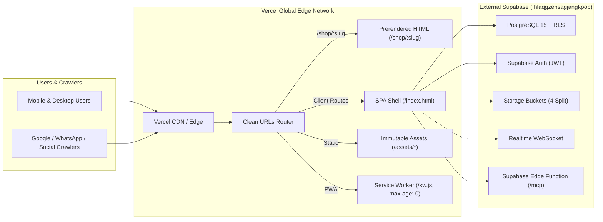

# Muktainagar Daily — Vercel Migration Plan & Production Runbook

> **Target Platform:** [Vercel](https://vercel.com) (Frontend SPA + Edge CDN)  
> **Backend Platform:** External Supabase (`fhlaqgzensagjangkpop.supabase.co` — PostgREST, Auth, Realtime, Storage, Edge Functions)  
> **Status:** Ready for Deployment  
> **Author:** Antigravity Engineering  
> **Date:** October 2026  

---

## 1. Executive Summary & Target Architecture

Muktainagar Daily is a Vite 5.4 + React 18 + TypeScript SPA with client-side routing, PWA offline caching, and pre-build/post-build Node scripts for dynamic sitemap generation and SEO `<head>` prerendering.



### Key Architectural Behaviors on Vercel:
1. **Dynamic Head Prerendering:** During build, `scripts/prerender.ts` generates static files at `dist/shop/<slug>/index.html` with full `<title>`, Open Graph metadata, and `LocalBusiness` JSON-LD. With `cleanUrls: true` in `vercel.json`, Vercel serves these static files directly to crawlers and visitors without client JavaScript overhead.
2. **SPA Client Routing Fallback:** For non-prerendered routes (`/shops`, `/bus-timetable`, `/schools`, `/admin/*`, `/my-shop`, `/saved-shops`), Vercel falls back cleanly to `/index.html` via the SPA rewrite rule.
3. **Decoupled Backend:** All database queries, authentication tokens, file storage, and realtime subscriptions connect directly to the external Supabase project. No backend migrations are needed.

---

## 2. Pre-Requisites & Environment Variables Checklist

Set these environment variables in **Vercel Project Settings $\to$ Environment Variables** for **Production**, **Preview**, and **Development**:

| Environment Variable | Required | Value / Description | Example |
|---|---|---|---|
| `VITE_SUPABASE_URL` | **Yes** | Your Supabase project URL | `https://fhlaqgzensagjangkpop.supabase.co` |
| `VITE_SUPABASE_PUBLISHABLE_KEY` | **Yes** | Supabase anonymous public key | `eyJhbGciOiJIUzI1...` |
| `VITE_SUPABASE_PROJECT_ID` | **Yes** | Supabase project identifier | `fhlaqgzensagjangkpop` |
| `VITE_LOVABLE_CONNECTOR_GOOGLE_MAPS_BROWSER_KEY` | **Yes** | Google Maps JavaScript API key | `AIzaSy...` |
| `VITE_LOVABLE_CONNECTOR_GOOGLE_MAPS_TRACKING_ID` | Optional | Maps telemetry tracking ID | `f43bc5eec...` |
| `VITE_SITE_URL` | Recommended | Canonical production URL (used for sitemap and prerender canonical tags) | `https://muktainagardaily.com` or `https://muktainagar-daily.vercel.app` |
| `VITE_ADS_ENABLED` | Optional | Build-time ad kill switch (`true`/`false`) | `true` (default) |

> [!NOTE]
> Even if environment variables are not set during early test deploys, [src/integrations/supabase/client.ts](file:///c:/Users/Asus/Downloads/muktainagar-daily-main/src/integrations/supabase/client.ts) and the build scripts contain graceful fallbacks to the external Supabase project credentials.

---

## 3. Vercel Configuration (`vercel.json`)

The project includes a production-tuned [vercel.json](file:///c:/Users/Asus/Downloads/muktainagar-daily-main/vercel.json):

```json
{
  "$schema": "https://openapi.vercel.sh/vercel.json",
  "framework": "vite",
  "cleanUrls": true,
  "trailingSlash": false,
  "headers": [
    {
      "source": "/sw.js",
      "headers": [
        { "key": "Cache-Control", "value": "public, max-age=0, must-revalidate" },
        { "key": "Service-Worker-Allowed", "value": "/" }
      ]
    },
    {
      "source": "/manifest.json",
      "headers": [
        { "key": "Cache-Control", "value": "public, max-age=86400" }
      ]
    },
    {
      "source": "/sitemap.xml",
      "headers": [
        { "key": "Content-Type", "value": "application/xml" },
        { "key": "Cache-Control", "value": "public, max-age=3600, stale-while-revalidate=86400" }
      ]
    },
    {
      "source": "/assets/(.*)",
      "headers": [
        { "key": "Cache-Control", "value": "public, max-age=31536000, immutable" }
      ]
    },
    {
      "source": "/(.*)",
      "headers": [
        { "key": "X-Content-Type-Options", "value": "nosniff" },
        { "key": "X-Frame-Options", "value": "SAMEORIGIN" },
        { "key": "X-XSS-Protection", "value": "1; mode=block" },
        { "key": "Referrer-Policy", "value": "strict-origin-when-cross-origin" }
      ]
    }
  ],
  "rewrites": [
    { "source": "/(.*)", "destination": "/index.html" }
  ]
}
```

### Critical Header Invariants:
1. `/sw.js` **must never be cached by edge CDN** (`max-age=0, must-revalidate`). If cached, clients will be trapped on old versions of the application shell.
2. `/assets/*` are content-hashed by Vite and cached for 1 year (`immutable`).
3. Security headers (`nosniff`, `SAMEORIGIN`, `strict-origin-when-cross-origin`) protect against clickjacking and MIME sniffing.

---

## 4. Step-by-Step Vercel Deployment

### Method A: Deploy via GitHub / GitLab / Bitbucket (Recommended)

1. **Initialize Git Repository & Push:**
   ```bash
   cd c:\Users\Asus\Downloads\muktainagar-daily-main
   git init
   git add .
   git commit -m "feat: vercel compatibility and production readiness"
   git remote add origin https://github.com/<your-username>/muktainagar-daily.git
   git branch -M main
   git push -u origin main
   ```
2. **Import into Vercel:**
   - Go to [vercel.com/new](https://vercel.com/new).
   - Select your repository (`muktainagar-daily`).
   - Framework Preset: **Vite** (auto-detected).
   - Build Command: `npm run build` (auto-detected).
   - Output Directory: `dist` (auto-detected).
   - Install Command: `npm install` (auto-detected).
3. **Configure Environment Variables:**
   - Expand the **Environment Variables** section and add the keys from Section 2.
4. **Deploy:**
   - Click **Deploy**. Vercel will run `prebuild` (sitemap), `build` (Vite compilation), and `postbuild` (prerendering), then publish the deployment.

---

### Method B: Deploy via Vercel CLI

```bash
# 1. Install Vercel CLI globally
npm i -g vercel

# 2. Login to your account
vercel login

# 3. Link project and deploy preview
vercel

# 4. Deploy to production
vercel --prod
```

---

## 5. Supabase Auth Configuration (Mandatory Step)

Once your Vercel deployment URL or custom domain is established, add it to your Supabase Auth whitelist to allow redirects for sign-in, sign-up, and password reset:

1. Open **Supabase Dashboard** $\to$ Project `fhlaqgzensagjangkpop`.
2. Navigate to **Authentication $\to$ URL Configuration**.
3. **Site URL:**
   - Set to your primary production domain: `https://muktainagardaily.com` (or `https://<project-name>.vercel.app`).
4. **Redirect URLs (Whitelisted Callbacks):**
   - Add: `https://<project-name>.vercel.app/**`
   - Add: `https://<project-name>-*.vercel.app/**` (for preview deployments)
   - Add: `https://muktainagardaily.com/**`
   - Add: `http://localhost:8080/**` (for local development)

---

## 6. Custom Domain & DNS Records

To connect a custom domain (e.g. `muktainagardaily.com` or `muktainagardaily.in`):

1. Go to **Vercel Dashboard $\to$ Project Settings $\to$ Domains**.
2. Enter your domain: `muktainagardaily.com` and `www.muktainagardaily.com`.
3. Add the corresponding DNS records at your domain registrar (GoDaddy, Namecheap, Cloudflare, etc.):

| Type | Name / Host | Value / Target | TTL |
|---|---|---|---|
| **A** | `@` | `76.76.21.21` | Automatic / 300 |
| **CNAME** | `www` | `cname.vercel-dns.com.` | Automatic / 300 |

*Vercel automatically provisions and renews free SSL/TLS certificates via Let's Encrypt.*

---

## 7. Post-Migration Verification Checklist

After deploying to Vercel, verify these 10 core health indicators:

- [ ] **Homepage & Directory Render:** Open `/` and `/shops` — verify shops, categories, and recently added cards load.
- [ ] **Slug Routing & Prerender Head:** Inspect page source of `/shop/<slug>` — verify `<title>`, `<meta property="og:title">`, and `<script type="application/ld+json">` are present in raw HTML before client hydration.
- [ ] **Search & Synonyms:** Search for `"cake"`, `"दवा"`, or `"hospital"` — verify typo-tolerant suggestions render instantly.
- [ ] **Phone & WhatsApp Actions:** Click Call and WhatsApp buttons — verify links open `tel:` and `https://wa.me/` and engagement events log without errors.
- [ ] **PWA & Offline Registration:** Open DevTools $\to$ Application $\to$ Service Workers — verify `/sw.js` activates on production and unregisters on preview domains.
- [ ] **Authentication Flow:** Sign up with a test account, sign in, and test password recovery link.
- [ ] **Shop Owner Portal:** Visit `/my-shop` — test shop editing, map pin location picker, and realtime updates.
- [ ] **Admin Layout & Navigation:** Navigate to `/admin/overview`, `/admin/directory/shops`, `/admin/sections/schools`, `/admin/system/data`.
- [ ] **Public Listing Submission:** Open "List a Shop" modal, test the 4-step wizard, and submit a test draft.
- [ ] **MCP OAuth Endpoint:** Verify `https://fhlaqgzensagjangkpop.supabase.co/functions/v1/mcp` answers MCP client requests with OAuth challenge.

---

## 8. Rollback Protocol

If an unexpected regression occurs in production on Vercel:
1. In **Vercel Dashboard $\to$ Deployments**, find the previous stable deployment.
2. Click **Instant Rollback**.
3. Traffic is instantly switched at the Edge without re-running builds.
